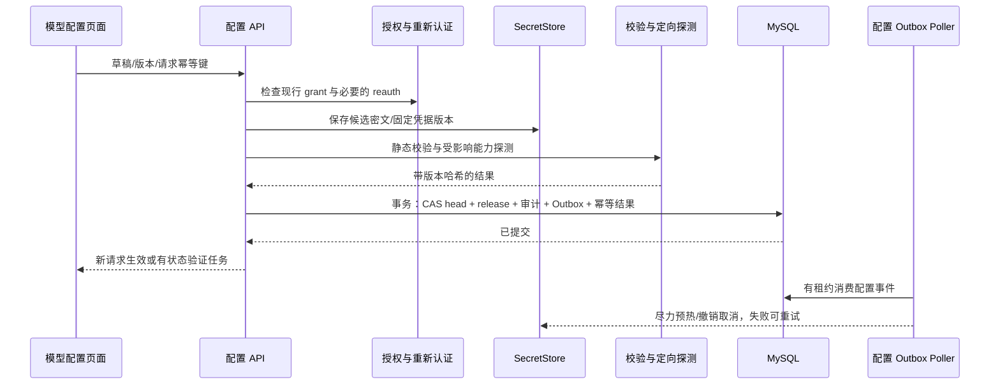
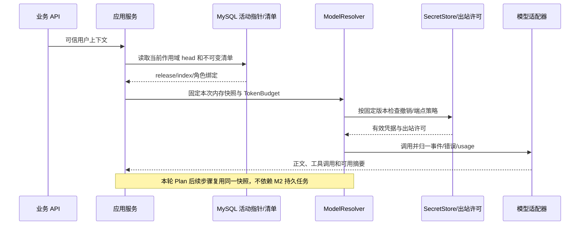
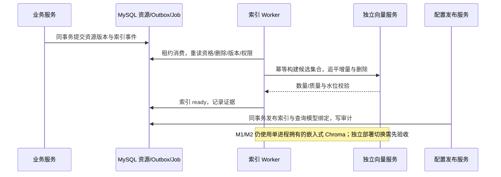
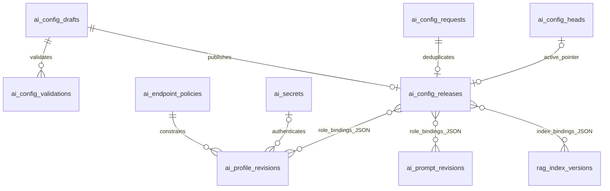

# 企业级 Agent 与模型配置热更新升级方案

日期：2026-11-16。版本：v1.4（加入 RAG 四层架构与多路召回，待实施设计基线）。编写：Codex；审查输入：用户提供的同日审查意见。适用项目：RagLearnCode 当前工作区。

需求来源：模型配置、OpenAI 兼容、Ollama 和热更新来自本次对话的用户需求；企业化缺口来自 2026-11-14 架构审查及当前代码复核。原 v1.0 为 603 行、v1.1 为 700 行；两轮审查原行号是历史定位，不指向当前行号。复审输入为同日《复审意见》，原两份审查文件保留。

术语：M0 为前置正确性基线；“第一阶段”“第一版”统一指 M1；M2—M4 为后续工作。配置清单通过附件 A 定义的角色引用不可变版本。附件 A—F 与正文共同构成设计基线，模型/记忆字段以 E、配置存储以 B、配置流程以 C、验收以 D 为准；M3 多路召回设计以 G 为准，其完整 Schema/API/DDL 尚待补齐；个人记忆流程以 F、存储以 08 为准。06/09 保留 v1.2/v1.3 历史证据，11 记录 v1.4 文档检查，均不能代替应用验收。

附件：[G RAG 四层与多路召回](./升级方案附件/10_RAG四层架构与多路召回设计.md) · [11 本轮文档验证](./升级方案附件/11_v1.4验证记录.md) · [F 个人记忆](./升级方案附件/07_个人记忆文件功能设计.md) · [08 记忆 DDL](./升级方案附件/08_个人记忆文件DDL.sql) · [09 v1.3 验证](./升级方案附件/09_v1.3验证记录.md) · [E 字段 Schema](./升级方案附件/05_配置契约.schema.json) · [06 验证记录](./升级方案附件/06_v1.2验证记录.md) · [A 角色注册表](./升级方案附件/01_角色注册表.md) · [B 数据模型 DDL](./升级方案附件/02_数据模型DDL.sql) · [C API 契约](./升级方案附件/03_API契约.md) · [D 里程碑验收矩阵](./升级方案附件/04_里程碑验收矩阵.md) · [审查处理记录](./企业级Agent与模型配置热更新升级方案_审查处理记录_2026-11-15.md)

目录：[1 范围](#s1) · [2 现状](#s2) · [3 架构](#s3) · [4 协议](#s4) · [5 配置与数据](#s5) · [6 提示词](#s6) · [7 热更新](#s7) · [8 Ollama](#s8) · [9 向量与 RAG](#s9) · [10 页面](#s10) · [11 API](#s11) · [12 安全](#s12) · [13 Agent](#s13) · [14 迁移](#s14) · [15 阶段](#s15) · [16 验收](#s16) · [17 上线](#s17) · [18 术语与决策](#s18) · [19 历史继承](#s19) · [20 个人记忆文件](#s20)

本文是分批实施中的升级设计，合并企业级 Agent、统一模型配置/协议/热更新和个人 Markdown 记忆需求。M0 首批正确性修复见[实施记录](./实施记录/M0_首批正确性修复_2026-11-16.md)。M1 的[授权与草稿](./实施记录/M1_模型配置控制面首批实施_2026-11-16.md)、[配置页与探测](./实施记录/M1_模型配置页面与能力探测_2026-11-16.md)和[发布与个人记忆](./实施记录/M1_模型发布热更新与个人记忆_2026-11-16.md)已接入。2026-11-17 接通[旧配置导入和合并](./实施记录/M1_旧配置导入与草稿合并_2026-11-17.md)、[向量目录登记](./实施记录/M1_现有向量索引基线登记_2026-11-17.md)及[人工核验后的向量绑定与连接更新](./实施记录/M1_请求级向量绑定与连接热更新_2026-11-17.md)。缺少原始构建证据的旧索引仍待核验。自动来源确认与新空间重建属于 M3 索引迁移工作，真实环境验收继续按附件 D 执行。

2026-11-17 增加[凭据紧急撤销与在途取消](./实施记录/M1_凭据紧急撤销与在途取消_2026-11-17.md)：配置页可查看凭据版本影响范围，管理员重新认证后撤销；事务提交后阻止新许可，并通过同进程注册表和 Outbox 尽力停止相关连接。旧快照、向量暖缓存和历史恢复均不能绕过撤销。撤销按本系统凭据版本生效，不撤销供应商侧 Key；完整 M1 验收和后续阶段仍待完成。

2026-11-17 增加[配置通知查询、死信补投与租约完成保护](./实施记录/M1_配置通知查询与死信补投_2026-11-17.md)。配置管理员可在同一模型配置页读取通知状态并重新认证后补投；原事件及失败次数保留，补投不重复发布配置或恢复凭据。此为 M1 同进程通知管理，尚未引入多进程消费或业务索引 Job。

2026-11-17 增加[候选配置生命周期与测试临时产物清理](./实施记录/M1_候选配置生命周期与测试产物清理_2026-11-17.md)：显式启用的后台任务处理草稿过期、候选退役及七天保留后的删除；历史发布、有效草稿、索引、验证租约和在途引用均保护，实际清单还作为引用登记之外的第二道检查。生产删除需独立维护账号。本轮仅在隔离库验证，未在业务库启用维护任务，运行中的前后端未重启。

2026-11-18 增加[主密钥轮换准备、只读引用盘点与隔离恢复验证](./实施记录/M1_主密钥轮换准备与隔离恢复验证_2026-11-18.md)：受控 CLI 生成独立的新密钥文件，保留历史版本，不自动覆盖或切换；盘点配置/个人记忆的 HMAC 与密文版本，可选验证解密。发布/恢复提交前新增密文可解密校验。隔离验证覆盖新密文/新发布、旧在途请求、备份及撤销保护。未执行业务密钥轮换或恢复；收尾按既有启动授权恢复了已停止的 Redis 和前后端，沿用原配置与已有 RDB。重排模型本地缓存缺失，尚未恢复其加载。

2026-11-18 接通发布后聊天模型的同端点有限重试，覆盖 OpenAI 兼容与 Ollama 原生的流式和非流式调用。[实施记录](./实施记录/M1_聊天模型有限重试_2026-11-18.md)

2026-11-18 模型配置页接入同服务备用模型。配置管理员可在当前角色保存备用绑定，并在发布前验证备用模型满足该角色的能力契约。新发布按请求快照固定主备配置。[实施记录](./实施记录/M1_同服务备用模型_2026-11-18.md)

2026-11-19 模型配置页接入显式 Responses 和双端点授权的跨服务备用。M2 接通凭据撤销通知丢失时的在途请求恢复。[M1 实施记录](./实施记录/M1_显式Responses与跨服务备用_2026-11-19.md) · [M2 实施记录](./实施记录/M2_凭据撤销通知丢失恢复_2026-11-19.md)

2026-11-18 接入从调用时间匹配价格版本的用量统计。用量页按币种展示已计价金额、历史估算及未知费用，并独立统计配置测试。[实施记录](./实施记录/M1_版本化计价与多币种用量_2026-11-18.md)

2026-11-18 接入可启用的请求内模型预算。聊天、Embedding、重试和备用模型共享调用次数、Token 与原币种费用限额。[实施记录](./实施记录/M1_请求内模型预算_2026-11-18.md)

2026-11-18 模型配置页新增上下文窗口和 Token 计数设置。已发布模型按实际发送内容执行窗口检查，空间不足时减少可选资料，保留本轮任务和必要规则。[实施记录](./实施记录/M1_模型上下文与Token计数_2026-11-18.md)

2026-11-18 开始 M2 可靠执行，先落地创建笔记、更新笔记和标记回顾的事务去重。工具重放使用已提交结果并重新校验权限。[实施记录](./实施记录/M2_事务型工具去重_2026-11-18.md)

2026-11-18 接入对话执行的 MySQL 检查点与所有者查询。记录固定发布版本、分支与计划步骤进度，成功状态随助手回复提交。[实施记录](./实施记录/M2_对话执行检查点_2026-11-18.md)

2026-11-18 接入聊天 SSE 的选择性事件续读。页面按序号补读进度和已提交回复，保留原有短对话停止机制。[实施记录](./实施记录/M2_SSE事件续读_2026-11-18.md)

2026-11-18 接入可选的只读后台对话。已受理运行可在 SSE 断开后继续，所有者可显式停止，结果沿用事件续读。[实施记录](./实施记录/M2_后台对话与显式停止_2026-11-18.md)

2026-11-18 后台对话接入跨进程取消。取消由共享数据库提交，执行进程读回取消状态后收尾。[实施记录](./实施记录/M2_后台对话跨进程取消_2026-11-18.md)

2026-11-19 只读后台对话接入 MySQL 持久派发。进程退出后，可由 Worker 重新领取，按原发布和原消息恢复生成并延续事件序号。[实施记录](./实施记录/M2_后台对话持久派发和Worker恢复_2026-11-19.md)

2026-11-19 只读后台计划接入步骤级检查点。输入一致时，Worker 可复用已完成的无工具步骤及其无工具依赖，事件仍沿原序号补读。[实施记录](./实施记录/M2_只读计划步骤恢复_2026-11-19.md)

2026-11-19 AI 助手接入新建笔记、更新笔记和标记回顾的写入审批。用户核对目标和参数后确认，决定、业务写入和幂等结果在同一事务提交。[实施记录](./实施记录/M2_AI写入审批_2026-11-19.md)

2026-11-19 AI 助手接入邮件审批和结果核对。用户确认后登记单次 SMTP 提交，超时或中断保留 Message-ID 供人工核对。[实施记录](./实施记录/M2_邮件审批与结果核对_2026-11-19.md)

2026-11-19 后台对话模型预算持久化。Worker 接管后沿用原任务的调用数、Token 及费用上限，保留无完整回执的调用预留。[实施记录](./实施记录/M2_后台模型预算持久化_2026-11-19.md)

2026-11-19 M2 完成本地验收。后台审批和文件操作按步骤恢复，文件事件可断点补读，Redis 通知与数据库轮询共同支持跨进程撤销。M2 的预算和回执迁移已应用到本地开发库。[阶段验收](./实施记录/M2_副作用步骤恢复与阶段验收_2026-11-19.md)

2026-11-19 开始实施 M3。知识库文件入库由 MySQL 任务驱动，SSE 读取进度。删除先撤销文档可见性，再清理原文件和向量。[实施记录](./实施记录/M3_知识库持久入库任务_2026-11-19.md)

<a id="s1"></a>

2026-11-17 后续增量：现有向量集合先支持[目录检查/待核验登记](./实施记录/M1_现有向量索引基线登记_2026-11-17.md)，再接通[管理员构建证据核验、固定索引/查询绑定和同空间连接更新](./实施记录/M1_请求级向量绑定与连接热更新_2026-11-17.md)。未核验空间不能发布，新空间重建/切换仍为 M3 关口。

## 1. 结论与交付范围

升级可行。保留 FastAPI、React、LangChain/LangGraph、MySQL、Redis 和现有业务服务，以模块化单体逐步演进。第一项完整交付应是“模型管理后端 + 模型配置页面 + 所有调用入口迁移 + 热更新验证 + 个人记忆文件增量”，随后补齐可靠执行、工具授权和 RAG 索引治理。

“统一成 OpenAI 接口”在本方案中指项目调用模型服务时优先采用 OpenAI 兼容协议。现有业务 API 和前端 SSE 契约继续使用；向第三方提供一个新的 OpenAI 代理服务不在本次范围内。

| 用户需求 | 升级后的行为 | 边界 |
| --- | --- | --- |
| AI 接口统一 | 通用聊天优先走 Chat Completions 兼容适配器，向量走独立 Embeddings 适配器 | 非兼容服务和供应商扩展通过专用适配器处理 |
| 手动修改服务商 URL 和 API Key | 页面逐项编辑、测试、保存并生效 | 调用和密钥保存由后端完成 |
| 多个模型分开配置 | 附件 A §A1 的 17 个角色分别绑定，基本/高级只是页面分组 | 支持同一任务链混用云端与本地服务 |
| 配置放在一个页面 | 一个“模型配置”页面，使用功能分组和提示词、版本记录页签 | 普通使用路径不要求用户理解内部实现 |
| 编辑系统提示词 | 在同页编辑各功能的系统提示词与任务模板 | Embedding 无系统提示词；模板变量及结果格式需要校验 |
| 手动热更新 | 保存并生效后，新请求取得新版本，进行中的请求保持原快照 | 应用配置热更新不等于修改 Ollama 服务进程环境或自动安装模型 |
| 兼容 Ollama | 提供 OpenAI 兼容模式与原生模式，支持不同部署地址 | 从后端所在环境判断连通性 |
| 可编辑记忆文件 | 头像菜单新增记忆文件，首次主 AI 助手请求创建，每用户一份 memory.md；下一轮按版本注入 | 手改受保护，记忆不越过系统规则；见 §20/F |
| 向企业级 Agent 演进 | 建立任务状态、工具授权、幂等、审计、版本和评测边界 | 专业子 Agent、组织共享和独立部署按后续阶段增加 |

企业化的验收重点是可授权、可恢复、可追溯、可验证和可运维。目录名称、Agent 数量、MCP 接入或微服务数量不能单独证明这些能力。安全与恢复设计参考 OWASP GenAI Security Project 于 2025-12-09 发布的 [OWASP Top 10 for Agentic Applications for 2026](https://genai.owasp.org/resource/owasp-top-10-for-agentic-applications-for-2026/)和 [LangGraph 持久化机制](https://docs.langchain.com/oss/python/langgraph/persistence)。

<a id="s2"></a>

## 2. 当前项目基础与需要改动的位置

| 当前实现 | 已有基础 | 本次升级需要解决的问题 |
| --- | --- | --- |
| [模型工厂（factory.py:116）](../app/utils/factory.py) | 集中创建对话、分类、规划、视觉、补全和 Embedding 模型 | 全局 MODEL_PROVIDER 限制混用；百炼 URL 固定；角色间共用服务商与 Key |
| [启动入口（main.py:125）](../main.py) | 分阶段初始化资源和管理关闭流程 | 持有启动时模型，缺少运行时版本解析入口 |
| [笔记服务（note_service.py:66）](../app/services/note_service.py)、[RAG 服务（rag_service.py:44）](../app/rag/rag_service.py) | 业务功能已通过服务封装 | 长期持有旧模型引用，不能仅替换 init_manager 上的字段 |
| [PPT 服务（ppt_service.py:70）](../app/services/ppt_service.py) | 已有独立大纲生成流程 | 绕过通用模型工厂，固定读取百炼配置 |
| [提示词加载（prompt_loader.py:21）](../app/utils/prompt_loader.py)、[提示词映射（prompt.yaml:2）](../config/prompt.yaml) | 文件模板及缓存已有统一入口 | 缺少编辑和版本发布；rag_summarize/report/reorder 三个映射文件缺失；RAG 摘要实际内嵌；导入时提取有效模板、移除未用死映射 |
| [对话路由（chat.py:121）](../app/routers/chat.py) | 有 SSE、模型路由、RAG 和历史压缩 | 路由职责过多，通过 main 获取全局依赖 |
| [编排图（chat_graph.py:104）](../app/ai_service/chat_graph.py) | 分类后选择 ReAct 或 Plan-Execute | 没有持久检查点；状态包含模型、服务、队列等运行对象 |
| [工具注册（tool_registry.py:22）](../app/ai_service/tool_registry.py)、[工具实现（agent_tools.py:148）](../app/ai_service/agent_tools.py) | 有分组、上下文绑定、归属检查和审计基础 | 分组不等于执行授权；空结果回退全量工具不适用于受限 Agent |
| [后台任务入口（task_runner.py:27）](../app/core/task_runner.py) | 有活跃任务上限和失败日志 | 8 个调用点全部未判空；chat_graph 无生产者时等待队列，取消清理时又会调用 None.done；M0 修复，可靠任务在 M2 持久化 |
| [向量服务（vector_store.py:26）](../app/rag/vector_store.py) | 有用户过滤、向量缓存和维度检查 | 缺少模型语义版本与索引版本绑定，内容哈希缓存未包含模型标识 |
| [用户模型（user.py:17）](../app/models/user.py) | 有用户认证和账户状态 | 缺少配置管理角色，组织权限需后续补齐 |
| [CI（ci.yml:16）](../.github/workflows/ci.yml)、[评测（eval_runner.py:84）](../tests/eval/eval_runner.py) | CI 有 pytest、前端 lint/单测/类型检查/构建及锁定依赖安装；关键词评测为依赖运行中服务的独立手动脚本，不在 CI | 需增加协议、热更新、权限、业务结果和故障恢复验证 |

详细 Agent/RAG 问题可结合现有[企业化架构审查](./多Agent与RAG企业化架构审查_2026-11-14.md)阅读。该报告里的历史测试结果不作为本方案已实施或已通过验收的证据。

<a id="s3"></a>

## 3. 目标架构与模块边界

各模块先在模块化单体内实现。以下三张时序图分别说明发布、请求和索引；M1 不把“图里有 Worker”当作已经完成可靠运行。

### 3.1 配置发布（M1）



### 3.2 请求快照与出站授权（M1）



### 3.3 索引构建与发布（M3）



建议新增职责为 application（用例）、llm/adapters（快照与协议）、tools（执行授权）、runtime（状态和预算）。M1 先抽 llm/application，ai_service 兼容函数只委托新解析器；M2 再迁 agents/tools/runtime，M3 增 workers。routers、services、models、schemas、db 沿用。

一个请求只解析一次；新入口通过功能开关整条替换，兼容导出不再独立读环境变量或双写审计。迁移后静态扫描及附件 D 的 17 角色测试证明无旧解析入口、SSE 回归通过，才删除旧实现。服务不反向导入 main，依赖通过明确入口注入。

<a id="s4"></a>

## 4. 模型协议统一与能力适配

### 4.1 区分业务用途、接口协议和服务商

三者分别配置：

- 用途 role：chat、planner、vision、embedding 等，决定调用场景。
- 适配器 adapter_type：openai_compatible、ollama_native、dashscope_native（M1 保留原生向量空间）；api_protocol 另记录具体协议，枚举见附件 B/E。
- 服务商 vendor：openai、dashscope、ollama、custom 等，用于预设、扩展参数和审计。

不能继续用一个全局服务商枚举决定所有模型。选择“自定义 OpenAI 兼容”时，只要求提供符合相应协议的端点，不限定模型名称列表。

M1 默认 Chat Completions。管理员显式选择 `api_protocol=responses` 并通过角色探测后，后端按发布快照请求 `/responses`。HTTP 网关选择路径和参数并归一化输出，配置参数不会触发协议推断。具体契约见附件 A §A4。

OpenAI 官方说明参数支持会随模型变化，因此工具、结构化输出、温度、Token 上限和思考参数需要分别验证。[OpenAI Chat Completions 参考](https://developers.openai.com/api/reference/resources/chat/subresources/completions/methods/create)

### 4.2 模型管理模块的最小职责

| 组件 | 职责 |
| --- | --- |
| ConfigRepository | 加载活动发布版本、模型版本和提示词版本；处理并发发布 |
| ModelResolver | 根据可信作用域、角色和配置快照找到明确的模型版本 |
| ClientRegistry | 按作用域、配置版本和凭据版本缓存客户端，管理旧实例生命周期 |
| ProviderAdapter | 构造请求、映射参数、转换流事件、使用量与错误 |
| CapabilityValidator | 验证当前角色所需能力，记录支持、不支持、未验证三种状态 |
| PromptResolver | 加载已发布提示词版本，执行变量校验和模板渲染 |
| SecretStore | 后端加解密和凭据撤销，禁止向普通配置响应返回明文 |

向现有 LangChain Agent 提供兼容的模型对象或包装器，不在 M1 另造一套 Agent 框架。DashScope 原生向量不强转兼容端点；新包装器逐次显式 Key/地址，避免原封装全局凭据状态，见附件 A §A5。模型接口按聊天和 Embedding 分开；重排序和 TTS 保留各自能力接口。

### 4.3 兼容能力矩阵

每个模型版本记录或验证以下能力：文本、流式输出、工具调用、JSON/结构化输出、图片、视频、思考控制、可用的思考摘要或供应商扩展内容、Token 使用量、Embedding、可选维度设置。

规则：

1. 被选为工具型 Agent 模型时，需要验证工具调用；单纯“能聊天”不能作为完整通过依据。
2. 规划与 PPT 大纲需要结构化结果校验；模型不支持原生 JSON 模式时，可显式选择“文本 JSON + 严格解析和有限重试”，页面显示真实状态。
3. 图片、视频和思考控制分别判断；不能因为支持图片就显示支持视频。
4. 未返回使用量时记录 unknown/null，不能按零消耗计算；不支持流式 usage 时不强制发送相应扩展字段。
5. 不向所有模型注入百炼 enable_thinking；参数只由适配器按已验证能力发送。
6. 既有 DashScope→OpenAI 专项对锁定 langchain-openai 1.3.5 已实测：reasoning_content 不透传；Responses 的 content 为列表，当前字符串累加会失败。M1 继承该结论，通过包装器或禁用不支持的进度显示处理扩展，stream.py 先支持 str/list，不能把它们重置为未知事实。

LangChain 官方说明 ChatOpenAI 面向 OpenAI 标准，不提取和保留 reasoning_content 等第三方非标准字段。普通兼容调用可复用 ChatOpenAI；需要扩展能力时，选择专用集成或受控 SDK 包装器，经契约测试后接入。[ChatOpenAI 集成边界](https://docs.langchain.com/oss/python/integrations/chat/openai)

能力探测请求、费用/调用次数上限、有效期和 unverified 的禁止新启用策略统一见附件 A §A3；上下文窗口、tokenizer 和 Embedding 编码见 §A4。运行时故障与已有角色降级统一见附件 C §C6。

### 4.4 URL 与请求规则

- Base URL 是 API 根路径，不填写完整的 chat/completions 路径。兼容端点常见以 /v1 结尾，也允许供应商提供的其他根路径。
- 只做协议、主机、路径和末尾斜杠校验，不无条件追加 /v1；原生 Ollama 使用服务根地址。
- 超时至少区分连接、单次调用和工作流总截止时间；本地冷启动可以采用更长首响应预算。
- 列举模型属于可选辅助功能；端点没有 models 接口时，仍允许手动填模型名。
- 不自动跨供应商重试。跨供应商降级需要明确的能力、预算和数据出站策略，绑定在已发布版本中。

<a id="s5"></a>

## 5. 多模型配置、作用域与数据模型

### 5.1 角色定义与边界

[附件 A §A1](./升级方案附件/01_角色注册表.md)是唯一角色注册表，完整列出 17 项 role_key、中文名、现有来源、默认绑定、prompt_key、入口与验收 ID；基本区 8 项、高级区 9 项。正文和页面不能各维护一个近似枚举。

PPT 大纲当前没有独立环境变量，直接复用 DASHSCOPE_CHAT_MODEL/Key 和固定百炼地址；导入后复制为 ppt_outline 的独立绑定。标题默认来源是 classifier_model，综合与反思是两个角色。选择“共用模型”显式登记 follow_role/follow_execution，独立修改转为 explicit 并展示引用影响。

本地 CrossEncoder 当前 compute_score 与安装版本不匹配，M0 改为 predict、归一分数并验证实际重排；其与 edge-tts 不伪装为聊天模型。M1 页面可展示独立能力状态，不延续失效路径。memory_extraction 因个人 Markdown 新需求进入 M1；memory_embedding 与向量记忆检索仍为 M4 reserved，独立集合和向量绑定，不声称已实现。

### 5.2 M1的作用域决定

M1交付“管理员维护全站模型配置”。这与当前全局模型实例结构最接近，也能最快完成完整闭环。

M1 使用附件 B 的配置角色 grant 和授权版本表；管理员通过部署初始化命令按 users.uuid 指定。不能按用户名等于 admin 授权，不能依赖前端隐藏按钮。附件 C 的权限矩阵区分读取、编辑、测试、发布、恢复、撤销、审计和管理授权。

数据结构保留 scope_type、scope_id。系统作用域采用固定非空 ID，避免空值唯一约束的歧义。个人配置、组织配置后续按阶段增加；在相应授权实现前，不开放客户端任意提交 scope_id。

后续有效配置可以按“个人明确覆盖 → 组织默认 → 系统默认”解析，但必须校验组织策略和凭据使用权限。Embedding 解析还需服从知识库活动索引，不能因用户临时改了个人模型就自动替换共享库的向量模型。

### 5.3 数据模型与发布清单

[附件 B](./升级方案附件/02_数据模型DDL.sql)提供 MySQL 8 DDL 草案，统一使用非空的 (scope_type, scope_id)，系统取 (system, system)。草稿、发布清单和活动指针是三个不同对象，不能用同一行的模糊 status 代替。

| 对象 | M1 落点与职责 |
| --- | --- |
| 版本计数与管理授权 | ai_version_counters、ai_config_admin_grants、ai_config_authorization_heads |
| 端点与凭据 | ai_endpoint_policies、ai_secrets：不可变内容版本、origin、撤销状态和 epoch |
| 模型与提示词 | ai_profile_revisions、ai_prompt_revisions：完整协议/认证/上下文/维度/安全策略字段 |
| 草稿与验证 | ai_config_drafts、ai_config_validations：ETag、过期、能力哈希、有效期和测试状态 |
| 请求幂等与恢复 | ai_config_requests：固定 action_payload、带版本 HMAC、执行状态、租约/次数/截止和重放结果 |
| 发布与活动指针 | ai_config_releases、ai_config_heads：raw/静态/动态绑定、单来源 release 编号与 CAS、M1 管理租约 |
| 索引基线 | rag_index_versions：M1 仅登记和阻止不兼容更新；重建 Job 在 M3 |
| 审计、引用与通知 | ai_config_audits、outbox_events、draft_items/release_refs：事务审计、反向引用、候选退役和通知重试 |
| 定价与追踪 | model_price_versions 及现有 model_traces/tool_call_audit 的增量字段 |

下图中的 JSON 边是应用层契约校验，不代表已经有物理外键；实体字段和真正外键以附件 B 为准。



字段 schema 以附件 E 为准；RoleBinding 原始结构见附件 A §A2。发布分开保存 role_bindings_raw、resolved_static_bindings、follow_execution_roles；实际动态选择入 trace。绑定内容为：每个角色有 enabled、selection、profile_revision_id、credential_revision_id、prompt_revision_id、fallback、failure_mode；索引绑定同时固定 index_version_id、query_profile_revision_id、credential_revision_id。凭据标识与版本必须一致且同作用域，禁止按“最新密钥”动态覆盖历史快照。

新草稿/发布使用 schema_version=2（17 角色），历史 v1 用 LegacyReleaseManifest 读取；克隆/恢复时补禁用的 memory_extraction 后编译为 v2，不改变旧快照。个人文件以用户 revision/head/epoch 管理，不进入系统模型 release，扩展表见 08。

发布内容不可变；draft_version 管理编辑并发，head_version 管理活动发布并发；修订号生成和唯一约束见附件 B/C。JSON 绑定通过应用层逐项校验角色/版本/作用域与反向引用，不能只验证是合法 JSON。M2 的 workflow_runs/agent_tasks/task_events/tool_operations/operation_approvals 沿用既有审查模型，字段草案在附件 B 末尾。

### 5.4 模型参数和密钥更新语义

每个模型版本至少包括：协议、服务商、Base URL、模型名、认证方式、超时、最大输出 Token、可选温度、角色所需能力、供应商参数白名单。Embedding 另有维度与语义模型版本标识。

Key 更新动作显式分为 keep、replace、clear：

- keep：保持已有凭据；页面留空不等于清空。
- replace：提交新 Key，生成新的凭据版本。
- clear：显式移除凭据，仅在目标认证模式允许时通过。

返回按角色标识的 credential_states 数组和按索引标识的 index_credential_states，不是全局单 Key 对象；派生状态见附件 C/E。掩码不能当新 Key 提交，存储、脱敏及跨 origin 规则统一见 §12。

<a id="s6"></a>

## 6. 系统提示词与任务模板管理

提示词按角色用途管理。统一信息架构为“左侧角色列表 + 右侧连接/提示词/版本记录/高级四个页签”，基本区与高级业务区都来源于附件 A；不再保留另一套页面枚举。

迁移覆盖以下来源：

- prompts 目录现有文件和 config/prompt.yaml 映射。
- 自动标签、补全等服务中内嵌的 system 文本。
- PPT 大纲、RAG 摘要、记忆压缩中单独构造的任务文本。
- classify、plan、synthesize、reflection 的角色和结果要求。

发布前校验变量白名单、必填变量、模板可渲染性和结果契约。当前使用 str.format 的模板包含 JSON 花括号时需要正确转义或迁移到经过验证的模板渲染方式，不能对任意用户文本无条件做字符串格式化。

现有 main_prompt 和 plan_generation 的安全段在 M1 导入时经人工核对拆成服务端版本化固定策略，由 ContextComposer 构造高权限消息，页面只读展示 safety_policy_version；业务文本和任务模板可编辑。固定策略变更随受控代码/策略发布，不通过此页面删除。固定文本仍不能保证消除提示注入，工具权限、身份、资源归属和外发授权必须在服务端独立执行。注入回归见 M1-11。

记忆、RAG、引用笔记、附件文本和压缩摘要以低权限数据注入，不能再追加到 system_prompt。普通/视觉/Plan/综合/反思使用 ContextComposer，顺序、预算和当前问题优先于旧偏好见 §20/F4。

新会话和旧会话的下一轮请求都默认取得当前活动版本；历史消息保留原样，历史 trace 保存当时版本。进行中的工作流固定原模型和提示词快照，不在某个中间步骤切换到最新配置。

prompts 文件作为安装默认值和迁移来源；已完成配置导入后，数据库已发布版本是运行事实来源。日常页面编辑不回写仓库文件，也不通过热重载源代码生效。

<a id="s7"></a>

## 7. 热更新的准确语义与发布流程

### 7.1 生效边界

| 情况 | 预期行为 |
| --- | --- |
| 保存草稿 | 不影响当前运行 |
| 发布成功后受理的新请求 | 使用新发布版本 |
| 发布前已经解析快照的请求 | 继续使用旧版本，直至本次请求结束 |
| 同一父任务的后续子步骤 | 使用父任务绑定的同一发布版本 |
| 旧会话的新一轮提问 | 使用当前活动版本，历史版本可追溯 |
| 参数校验、能力测试或准备客户端失败 | 活动指针保持旧版本，草稿可修正 |
| 已发布凭据被外部服务撤销 | 相应请求明确失败；不能假定回滚配置能恢复凭据 |
| 个人记忆普通保存 | 下一轮取得新 revision，本轮和 Plan 子步骤保持原记忆快照 |
| 个人记忆停用或清空 | 增加 memory_epoch，停止新出站许可及旧任务回写；已发送内容尽力取消，见 F6.1 |
| 紧急撤销凭据或授权 | 拒绝撤销后新取得的出站许可，在途尽力取消；准确边界见附件 C §C5 |

“正在生成的回答继续运行”只适用于普通配置变更。凭据泄漏后的紧急撤销、用户取消和权限撤回可以中断执行，需要单独审计。

凭据普通替换、紧急撤销、出站许可线性化点和在途三态以附件 C §C5 为准。普通替换生成新密文行并随新 release 生效，旧在途快照不换 Key；紧急撤销不需要新 release，数据库停止新的许可并尽力取消在途，不能保证撤回上游已受理效果。

### 7.2 发布流程

1. 页面提交草稿、预期 head_version 和发布请求幂等键。
2. 后端校验管理权限、目标地址、密钥动作、参数、引用关系、提示词变量与必需能力。
3. 按附件 A 的目标哈希决定受影响探测：连接/凭据/协议/能力改变要测；纯提示词文案只做静态校验，已有能力兼容的绑定可复用有效结果。测试不用用户笔记，不执行真实业务工具；is_test=true。慢验证返回有状态任务，不在长数据库事务中等待网络。
4. M1 新空间只保存 pending_rebuild 草稿并拒绝发布；M3 才创建迁移 Job，不直接改变现有索引查询模型。
5. 在同一数据库事务核对草稿 ETag、当前授权、验证版本和 expected_head_version，插入不可变 release，CAS 更新 head，写发布审计、配置 Outbox、草稿 published 状态和幂等结果；冲突回滚并返回 409。
6. 事务提交后返回新 release_id、head_version、发布时间和验证摘要；页面更新已生效状态。
7. M1 同进程 Outbox poller 尽力预热和处理撤销取消，最多 5 次退避重试后进入 dead_letter 并告警；M2 才增加 Redis/多消费者。旧客户端按在途引用回收，不关闭共享连接池仍在服务的其他对象。

验证保存可解释的 target_spec，按附件 C §C3 的 JCS/SHA-256 纳入角色/参数/凭据/适配器/端点/安全/探测版本，草稿修改使相关结果失效。重复发布请求先读取持久幂等记录；同一请求幂等键（request_key）对应不同 payload_hash 时返回冲突。共享 HTTP 连接池由注册表统一管理，回收一个模型对象不能关闭其他在途模型仍使用的连接池。

网络探测发生在数据库提交之前，不能把发布期间一次成功解释为后续服务永远可用。提交前失败保持旧配置；发布后出现故障时，通过明确的回滚或已配置降级策略处理。

### 7.3 数据库、进程与多实例一致性

数据库提交和进程内对象替换无法组成一个普通本地原子事务。本方案以数据库活动指针为准，不依靠一次清缓存假装全局原子切换。

M1每个新请求从数据库读取一次当前作用域活动指针和清单版本；不可变清单与客户端按版本缓存。请求完成快照解析后不再追随活动指针。缓存 Key 至少含作用域、profile_revision、credential_version，禁止跨用户误复用。

M2 的 Redis 通知用于加速预热；订阅重连和通知丢失由数据库版本读取兜底。不能只用 Pub/Sub 维护正确性，也不能宣称所有进程内对象在同一时刻同时替换。无法取得活动版本时默认明确失败，不静默重新读取 .env 切换服务商。

运行配置快照只向持久任务保存 release_id、模型/提示词版本 ID 和安全的策略引用；不把 SDK 客户端、明文 Key、数据库连接、asyncio.Queue 放入检查点。恢复任务重新构造运行依赖，并重新校验凭据和权限是否仍有效。

M1 的父任务快照指现有 Plan 在一个请求中的内存对象，不包括重启恢复。持久任务引用、恢复和事件重连归 M2；多进程解析器契约测试不代表允许多个进程共享当前本地 Chroma 目录。

### 7.4 模型引用迁移

仅赋值 init_manager.chat_model 不够。NoteService、RagService、PPT 等入口统一改为接收模型解析器或每次业务调用明确传入已解析模型。

对话路由从应用依赖入口取得配置快照，应用服务为主回答、标题、压缩、规划、反思和附件选择模型。后台标题任务继承触发请求的配置版本；没有父请求的定时任务在被受理时解析一次活动版本。

兼容工厂可以保留原函数签名作为过渡包装，但内部必须委托新模块，不能留下另一套独立的环境变量解析逻辑。

<a id="s8"></a>

## 8. Ollama 的完整配置方案

### 8.1 两种模式

| 字段 | Ollama OpenAI 兼容模式 | Ollama 原生模式 |
| --- | --- | --- |
| adapter_type | openai_compatible | ollama_native |
| vendor | ollama | ollama |
| 本机 Base URL | http://localhost:11434/v1 | http://localhost:11434 |
| 典型聊天路径 | /v1/chat/completions | /api/chat |
| Key | 标准本地服务可不填，SDK 需要时后端补占位值 ollama | 标准本地服务通常不需要 |
| 模型名 | 已安装模型的完整名称和标签 | 同左 |
| 特有配置 | 按兼容接口能力选择 | 可映射 options、think、keep_alive 等 |

Ollama 官方说明其兼容 OpenAI API 的一个子集；本地示例使用占位 Key，聊天和 Embeddings 端点均有对应说明。模型仍需具备被分配任务需要的实际能力。[Ollama OpenAI 兼容文档](https://docs.ollama.com/api/openai-compatibility)

默认优先提供兼容模式；需要原生控制或扩展内容时选择原生模式。原生参数只发给相应适配器，并按所安装版本和模型验证。[Ollama 原生聊天 API](https://docs.ollama.com/api/chat)

使用 Ollama 云端地址或经过鉴权代理时需要真实凭据，页面不能因为 vendor 是 ollama 就一律忽略 Key。认证模式由具体端点配置决定。

### 8.2 不同部署方式的地址

| 后端部署 | Ollama 部署 | 兼容模式示例 Base URL |
| --- | --- | --- |
| 本机进程 | 同一台机器进程 | http://localhost:11434/v1 |
| Docker Desktop 容器 | 宿主机进程 | http://host.docker.internal:11434/v1 |
| Docker Compose 容器 | 同网络内名为 ollama 的服务 | http://ollama:11434/v1 |
| Linux Docker Engine 容器 | 宿主机进程 | 配置 host-gateway 映射后使用相应主机名 |
| 服务器进程或容器 | 另一台机器 | 后端可访问的受控内网地址或鉴权 HTTPS 网关 |

Docker Desktop 提供 host.docker.internal 指向宿主机；Compose 同网络服务可通过服务名解析。[Docker Desktop 网络说明](https://docs.docker.com/desktop/features/networking/networking-how-tos/)、[Compose 网络说明](https://docs.docker.com/compose/how-tos/networking/)

Linux Engine 如需要主机名映射，可在 backend 服务中按部署环境增加如下配置。这是实施片段，不表示当前 compose 已有 Ollama 服务：

```yaml
services:
  backend:
    extra_hosts:
      - "host.docker.internal:host-gateway"
```

Ollama 必须监听后端实际可达的接口，监听地址和网络访问范围由部署配置控制。修改 OLLAMA_HOST 等服务进程环境通常需要重启 Ollama；网页热更新只改变本项目的连接配置。[Ollama 服务配置说明](https://docs.ollama.com/faq)

后端在远程服务器、Ollama 在用户电脑时，填写 localhost 无法连接到用户电脑。M1统一由后端调用；若以后需要浏览器侧本地服务或本地 Connector，另行设计身份和网络通道，不混入这次热更新实现。

### 8.3 模型、容量和上下文

- 模型名按已安装的完整标识填写；页面模型列表用于辅助，仍保留手工输入。
- M1不在保存配置时自动执行 ollama pull，不把模型安装混入发布事务。
- 分类和补全可以选小模型；规划和工具执行需要独立验证，不能按模型大小推断可靠性。
- 多项配置可以绑定同一个本地模型，不代表必须同时把多个模型常驻显存。
- 设置本地并发上限和排队超时，避免主回答、分类、补全同时挤占计算资源。
- 上下文窗口与输出上限区分。兼容接口无法覆盖的上下文配置使用经过验证的原生能力或预先创建的 Modelfile 模型，不随意透传未知字段。[兼容接口上下文说明](https://docs.ollama.com/api/openai-compatibility#setting-the-local-context-size)

### 8.4 原生/兼容端点与事件映射

| 能力 | OpenAI 兼容 | Ollama 原生 | 归一规则 |
| --- | --- | --- | --- |
| 聊天/流 | /v1/chat/completions | /api/chat | delta 或 message.content → response；done → 终止 |
| 工具调用 | choices[].delta.tool_calls | message.tool_calls | 统一 tool_call_id、名称和 JSON 参数；缺少 ID 时生成稳定运行 ID |
| 可用思考进度 | 受控扩展或显式协议块 | message.thinking（按版本/模型） | 映射 thinking 事件；不把内部字段直接当正文 |
| Embedding | /v1/embeddings | /api/embed | data[].embedding 或 embeddings → 同序浮点数组 |
| 模型发现 | /v1/models | /api/tags | 标识/标签归一，保留可获得 digest |

原生向量按当前官方 [API 使用 /api/embed](https://docs.ollama.com/api/embed)，模型发现用 [/api/tags](https://docs.ollama.com/api/tags)。旧 /api/embeddings 不作为 M1 目标；文档页面移除不能证明所有部署的旧服务路由都已删除，本地 SDK 仍有旧方法，实施以实际服务版本探测为准。

dimensions 和 encoding_format 按端点与模型验证；默认 float，不照搬 OpenAI 特定模型的限制。keep_alive 和 num_ctx 会影响显存/内存占用和并发，保留时间及窗口增大需要纳入本地排队与资源预算，不默认让所有模型永久常驻。

<a id="s9"></a>

## 9. Embedding 与 RAG 的特殊发布规则

### 9.1 不能把 Embedding 当作普通聊天热切换

| 配置变化 | 处理方式 |
| --- | --- |
| 同一向量模型、同一语义版本，仅更新 Key 或超时 | 校验后热更新连接，不要求重建 |
| 更换 URL，但确认服务的是同一向量模型版本 | 验证维度、语义身份和请求参数一致后更新 |
| 更换模型、模型修订、归一化或影响语义的维度参数 | 构建新索引，再发布活动索引 |
| 维度相同，但模型不同 | 仍按不同向量空间处理 |
| 仅更换聊天模型 | 不触发 Embedding 重建 |

维度一致只能排除一部分错误，不能证明向量空间一致。模型标签可能指向更新后的权重，需要记录可获得的模型修订和语义指纹；无法确认时采用新索引。

### 9.2 索引版本与配置绑定

语义指纹是规范化语义身份 JSON 的 SHA-256，字段为供应商/权重修订或 Ollama digest、维度、归一化、输入预处理、指令前缀/池化策略和相关模型参数；Key、超时、连接地址不进入语义指纹。另保存连接身份用于审计。跨端点必须有可信相同权重/修订证据才能共用空间。

固定双语/代码/短长文本探测集记录响应向量、维度与数值漂移，用于发现不一致；向量相似或哈希相同的少量样本不能单独证明语义等价，不设置一个未经质量评测的万能余弦阈值。证据不足标 unverified，按新空间重建或阻止切换。

索引版本记录构建时的 build_profile_revision_id、semantic_fingerprint、dimension、parser_version、chunker_version、index_version。请求快照中的 index_bindings 同时指定索引版本和用于查询的模型配置版本；解析器校验二者的语义指纹与维度一致，不能直接拿最新全局 embedding 配置查询任意集合。

构建模型版本用于追溯，查询连接版本允许更新：同一空间换 Key 时，发布清单引用原索引版本和新的 query_profile_revision_id，即可更新真实查询连接；不同空间则必须同时绑定已构建的新索引。这样既不会将查询永久锁在旧 Key 上，也不会把新模型向量发往旧集合。

向量缓存 Key 至少包含语义指纹、维度和文本哈希。凭据变更不必废弃同空间向量，但模型空间变化必须隔离缓存和集合。

迁移流程为“创建候选索引 → 后台重建 → 对齐重建期间增量和删除 → 校验数量、权限、质量 → 发布同时引用新索引和新查询模型的清单 → 保留旧索引和回滚条件”。活动索引引用与查询模型引用随同一个配置发布切换，查询向量、候选集合与权限核验固定同一快照。多知识库分批迁移时，每个逻辑索引保留各自兼容的绑定，不能整体替换为唯一的全局模型。

M1 只提供现有索引基线、同空间连接更新和不兼容变更拦截；新空间只能保存草稿，显示 pending_rebuild，不能发起后台重建或发布切换。M3 才交付 queued/building/catching_up/validating/ready_to_switch/switched；中文与配置状态映射统一见附件 C §C4。

### 9.3 RAG 企业化补齐项

统一 RetrievalService，供直接 RAG、笔记搜索工具和相关推荐使用；向量召回后批量回数据库核验用户、删除状态、资源版本及后续 ACL，再将正文送入重排和模型。

业务变更与索引 Outbox 在同一数据库事务提交。Worker 根据资源 ID 与目标版本读取已提交内容，幂等构建索引，拒绝旧任务覆盖新版本；删除采用 tombstone，失败清理不能让内容重新可见。增加重试、死信和对账任务。

入库逐步改成持久 Job：上传创建文档和任务，SSE/轮询只读取任务进度，页面断开不决定任务是否继续。保留原文版本、页码/章节、稳定切片 ID 和 Evidence 引用，方便评测和溯源。

### 9.4 向量存储部署决定

M1—M2 保持单实例嵌入式 Chroma，由一个进程拥有本地目录；M2 的可靠任务可以同进程持久消费，不让独立 Worker 并发挂载 SQLite。M3 启动前必须完成独立 Chroma 服务或其他受控向量服务的 ADR；本方案默认优先验证独立 Chroma 服务以减少接口变化，验证失败可另行选型，未过关不开放多实例索引。

迁移采用候选服务/集合并行构建、数量/权限/质量与增量水位核验、原子切换绑定；回滚需追平旧集合，不共享写文件冒充集群。如接入笔记向量可选化，Worker 重读 DB 的 is_indexed、deleted_at 和版本，仅重建具备资格的数据；当前代码尚无 is_indexed，不能把设计语义说成已实施。长期记忆以后使用独立集合及独立 embedding 角色。

### 9.5 四层优化与受控三路召回（M3）

采用索引、查询、召回、重排四层职责划分。基础两路为原问题向量召回和关键词召回，第三路为可选 Multi Query 扩展；它生成最多两个改写后仍调用检索器，不是独立索引。原问题始终保留，扩展内部先融合成一个限额列表，再与原问题两路做 RRF，避免多个改写在外层重复增加权重。

每类 Top-20、最多 30 条进入 CrossEncoder、最终最多 5 个证据块作为初始评测参数；权限、版本、相关性及 Token 预算优先，可返回更少或无答案。各路同一授权范围预过滤，数据库复核后正文才进入远程重排/摘要/回答。原问题基础召回不依赖扩展模型成功，失败按明确状态降级。

Multi Query 的采用取决于 M3 消融评测。M1 的 v2 清单保持 17 角色，M3 的 v3 清单支持独立发布 rag_query_expand。2026-11-24 本地对照未达到采用门槛，查询扩展和重排保持关闭，SQL 兜底继续可用。图谱检索和 LLM 重排保留独立 ADR。流程、预算、两级 RRF、元数据、双索引水位和验收见[附件 G](./升级方案附件/10_RAG四层架构与多路召回设计.md)。

<a id="s10"></a>

## 10. 前端“模型配置”页面

入口建议为设置中的“模型配置”，路由建议 /settings/models。页面沿用现有主题、组件、国际化和 API 客户端。

页面统一为：顶部活动 release/head 状态，左侧附件 A 的角色列表，右侧连接/提示词/版本记录/高级四页签；高级九角色默认折叠。窄屏采用角色下拉或折叠组，仍在同一路由。状态只从附件 C §C4 映射，不建立另一套词表。

| 页面区域 | 内容 |
| --- | --- |
| 用途导航 | 附件 A §A1 的 17 个 role_key/中文名，基本八项/高级九项只是分组 |
| 模型连接 | 服务商预设、协议、Base URL、认证方式、Key、模型名 |
| 生成参数 | 超时、输出上限、能力允许的温度和思考参数 |
| 提示词 | 系统提示词、任务模板、变量说明、渲染预览、恢复默认草稿 |
| 能力状态 | 已支持、不支持、未验证；展示当前角色缺失的能力 |
| 版本记录 | 脱敏差异、操作者、测试时间、发布时间、恢复某版本 |
| Embedding 状态 | M1 基线/查询连接与不可发起的迁移资格；M3 才显示真实 Job 进度 |

操作包括“测试连接”“保存草稿”“保存并生效”“恢复某版本”。保存并生效合并必要校验与发布，不额外增加人为审批流程；恢复历史版本也经过权限、凭据有效性和索引兼容检查。

Key 输入框默认空白，显示“已配置”状态和替换/清空动作。切换服务商只提供预设，不直接提交或覆盖其他功能配置。测试结果保留用户输入，并区分地址不可达、鉴权失败、模型不存在、能力不足、限流和超时。

页面区分未保存、草稿、验证中、已生效、失败、索引迁移待完成等状态。修改未保存时提示离开；发布中防重复提交。显示服务端有效配置，不把“浏览器表单保存成功”当成后端已切换。

普通用户不取得配置管理权限；后续个人 Key 功能开放后，清楚显示个人与系统来源，不能在同一表单里隐式修改全站默认。

<a id="s11"></a>

## 11. 后端 API 与错误契约

[附件 C](./升级方案附件/03_API契约.md)是唯一 API 契约表，补齐草稿 GET/DELETE、验证与请求结果读取、提示词列表/详情/恢复默认、M1 Embedding 只读状态、密钥状态、端点策略、grant、紧急撤销、审计分页及重新认证入口。

模型配置路径共用 /api/v1/model-config；个人记忆使用 /api/v1/user/memory，按当前用户授权，见 F6。配置接口沿用 code/message/data/request_id。Idempotency-Key 管幂等，If-Match 管草稿编辑，expected_head_version 管发布；422 与 409 的错误示例、effective_for 枚举和异步 202 语义均在附件中。M1 不开放 M3 的索引迁移能力，调用时明确 FEATURE_NOT_AVAILABLE，不以空实现返回成功。

ModelResolver 只接受可信作用域及 role_key，不接受用户任意 URL 作为运行参数。发现、测试和推理共用端点/凭据策略与限额。

<a id="s12"></a>

## 12. 安全与凭据生命周期

授权粒度、首次管理员初始化/撤销、重新认证和 Bearer/CSRF 条件统一见附件 C §C1；普通轮换与紧急撤销的完整三态、入口和取消边界见 §C5。§5.4 只定义字段动作，本节说明存储与出站安全。

### 12.1 密钥存储

使用成熟认证加密方案保存密文，例如 cryptography 提供的认证加密组件；加密主密钥通过部署 secret 注入，不存在数据库业务表、Git 或前端中。密文记录 key_version，绑定作用域和目标 origin；禁止自行设计加密算法。

页面 Key 通过受保护的后端连接提交。日志、异常、审计、配置导出、trace、测试结果统一脱敏。导出模板不包含明文凭据；备份恢复需要同时验证密钥材料可用，数据库备份本身不足以恢复解密能力。

凭据撤销、替换和主密钥轮换分别管理。回滚清单不能复活已撤销或已删除凭据；回滚预检查失败时，返回明确原因并保持现有活动指针。

### 12.2 自定义 URL 与 Ollama 内网访问

允许任意 URL 会使配置测试成为服务端请求入口；但现有公网 SSRF 守卫又会拒绝 localhost 和私网，不能原样套用后再整体关闭。

采用明确的模型连接策略：

- 公网服务默认 HTTPS，按管理员批准的服务 origin 和连接规则访问。
- 本地 Ollama、Compose 服务和私网模型允许明确登记的主机、端口和协议，由可信管理权限控制。
- 非 HTTP(S)、云元数据和危险链路本地目标拒绝访问。
- 默认关闭重定向；必要时逐跳验证目标，不跨 origin 发送原凭据。
- DNS 解析检查与实际连接地址保持约束，避免只检查一次字符串后由客户端连接到另一个地址。
- 测试、模型列表和实际推理共用同一出口策略；设置超时、并发、响应大小限制。

模型端点策略独立于网页抓取和 MCP 工具策略，允许可信 Ollama 不代表放开网页工具对所有内网的访问。反向代理和 HTTP 连接池配置也需纳入检查。

### 12.3 数据出站与能力降级

配置修改能够改变笔记、附件、个人记忆和摘要发往何处，因此记录目标 origin 与操作者；未来组织策略可以限制云端模型或跨区域出站。自动模型切换只在已发布并授权的候选内发生，不因主模型失败向未知服务发送内容。

<a id="s13"></a>

## 13. Agent 企业化升级工作包

### 13.1 执行正确性与持久运行

M0 承接既有阶段 0 的当前正确性修复，先执行 tool_call_audit 增列和横切错误契约迁移：后台任务 8 点拒绝处理；计划 ID/依赖/DAG 和无工具上下文；子任务取消；空工具授权；自然语言错误归一；审计 run_id/tool_call_id 精确匹配；MCP SSRF 真实 Schema；RAG 用户与双源路由、删除残留核验；CrossEncoder predict、跨源排名与降级。通过标准见附件 D §D1；R3/R5—R9 的混合检索、持久入库、证据、切片与资源治理有 M3 专项，不宣称都在 M0。计划非法时有限修正或明确失败，不能截断后留下失效依赖或无声丢步骤。

逐步增加 workflow_runs、agent_tasks、task_events 等持久记录。状态包括 accepted、running、waiting_input、succeeded、failed、cancelled；工具操作还有 unknown，表示上游可能执行但未收到确定结果。

把 WorkflowState 与运行依赖拆开，在有业务意义的步骤建立持久检查点。优先选与现有数据库和锁定 LangGraph 版本经过验证兼容的持久后端；若要引入新数据库，单独给出运维与恢复决策，不能把内存 Saver 当生产持久化。

持久任务、事件序号、Worker 租约与重试共同支撑重启恢复。短对话可随取消结束；长任务一旦受理，可独立于 SSE 连接继续执行，用户通过事件序号重连。页面断连与显式取消分别建模。

检查点和重试不能保证外部副作用只发生一次。LangGraph 官方要求设计幂等边界，对无确认响应保留结果不确定状态。[故障恢复与幂等说明](https://docs.langchain.com/oss/python/langgraph/fault-tolerance)

### 13.2 工具执行治理

建立 ToolSpec 与 ToolExecutor，统一包裹内置、MCP 和后续远程工具。工具规格包含输入/输出契约、读写类别、资源类型、所需权限、超时、幂等策略和审计要求。

有效权限为用户权限、Agent 角色权限、本次任务授权和资源权限的交集。未知工具和空授权默认拒绝。现有事件钩子用于观测，不能用吞异常的钩子替代真正的调用前授权。

对写笔记、生成外部产物、邮件发送等操作持久化 operation_id、参数哈希、状态和结果引用。重试返回已完成结果；结果不确定时先核对，不盲目重发。不支持上游幂等的外发操作，采用受控处理和必要的人工介入，不承诺跨系统严格 exactly-once。

人工确认仅用于按业务策略需要授权的具体副作用，绑定用户、操作、目标、参数哈希和有效期。不能依靠模型说“已经确认”认定授权。

### 13.3 专业 Agent 与协议演进

保留既有 Supervisor 方案 v1.1“已评审——决策不采纳”，M4 只保留研究选项，不自动重启实施。须先有单 Agent 工具面过载/质量或权限问题的测量证据，提出新 ADR，再做受限只读子 Agent 原型及双态对照。开关关闭时原 SSE 和业务轨迹一致；质量收益与延迟/成本同时验收。2026-11-14 审查中的 Supervisor 建议视为候选建议，不覆盖更早的明确否决决策。

任务与结果使用明确契约：task_id、parent_id、role、objective、input_refs、constraints、deadline、budget，以及 status、structured_data、evidence_refs、artifact_refs、error_code、usage。身份和权限由可信运行时绑定，不让模型填写。

内部优先使用类型化调用或 LangGraph 子图。出现独立部署、跨团队或异构 Agent 时再评估 A2A 适配；MCP 继续承担工具与资源接入。协议与 SDK 选型在该阶段核对并锁定，不把接入某个协议作为本轮模型配置交付的前置条件。

### 13.4 可观测性、成本与评测

扩展现有模型 trace、工具审计和指标，关联 release_id、profile_revision、prompt_revision、workflow_id、step_id、operation_id、provider_origin、adapter_type 和实际模型标识。

定价不能长期只依赖一个模型名：相同模型名可能来自不同端点、币种和价格版本。记录调用时价格版本，避免价格修改改变历史账单。未知使用量与配置为零单价区分，Ollama 的 API 费用可以配置为零，但不表示本地计算资源没有成本。

预算从单次上下文上限扩展到任务树的 Token、费用、模型调用数、工具次数、并行数和截止时间。根任务分配预算，子任务消耗额度，超限产生可解释的停止结果。

M0 复用 tool_call_audit，修复并发匹配；M2 把同一表关联到 operation_id 和持久任务，不双写两份同义审计。M0 对写步骤同资源串行，M2 再做版本条件写入与完整授权。MCP 工具白名单、描述 Token 预算和 Planner 动态目录感知一并继承。

评测继承既有“关键词规则 + LLM Judge，影子 → 校准分歧率 → 门槛”设计，并补充实际工具轨迹、资源状态、权限、证据支持、故障恢复、成本和延迟。稳定的假模型/假供应商协议测试进入 CI；真实模型质量评测单独在受控环境运行，保存服务、模型及提示词版本，避免每个普通 PR 都依赖真实服务。

<a id="s14"></a>

## 14. 迁移步骤与兼容策略

### 14.1 初始导入

1. Alembic 新增配置表和管理权限，不修改现有业务数据的语义。
2. 走附件 C §C3.1 的 bootstrap.import 内部动作，创建合法 request/draft/候选/验证/release/head/引用/审计/Outbox，不放宽外键。读取 env/百炼/Ollama/提示词，以及 config/agent.yaml 中 critic_model、token_budget；旧窗口只作兼容声明，不当远端能力证据。
3. 读取 .env 的动作只在服务端导入过程中执行，Key 加密入库，不进入终端输出或审计差异。
4. 已知 rag_summarize/report/reorder 三映射缺文件：rag_summarize 从真实内嵌文本提取，未使用的 report/reorder 映射在 M1 移除或标 deprecated，不新建空模板；其他内嵌 system 逐项导入。
5. 旧配置缺少某项模型时，记录原有显式降级关系或禁用状态，不在迁移时自动购买能力或下载模型。
6. 导入后数据库优先；DB_CONFIG_REQUIRED=true 的生产实例无活动发布则不接流量。仅 M0/M1 部署切换窗口允许显式 legacy 模式并记录来源，首个发布成功即关闭；不能因 DB 临时故障自动退回环境变量。规划中、代码不读的 OPENAI_* 示例变量只报告为待配置输入，不自动激活或与旧变量合并。

同时登记现有集合的索引清单。维度相同和当前 .env 模型名不能单独证明历史向量来源；无法确认的旧集合标记为待核验，按显式兼容模式保留导入时固定的原模型与集合组合，并禁止模型空间切换。该组合仍通过统一模型管理解析，不保留另一套环境变量调用入口；不能把推测的指纹登记为“已验证兼容”，后续通过核验或重建消除该状态。

### 14.2 调用入口迁移清单

| 完整仓库相对入口 | 调整 |
| --- | --- |
| main.py / app/utils/factory.py | 新依赖和单次解析，关闭 SDK/HTTP 传输隐式重试 |
| app/routers/chat.py / app/ai_service/agent_runner.py | 共用父快照，标题当前来自 classifier_model |
| app/ai_service/query_classifier.py / app/ai_service/plan_execute_agent.py / app/ai_service/reflection.py | 分类/规划/综合/反思与动态工具契约 |
| app/ai_service/multimodal_processor.py / app/ai_service/stream.py / app/ai_service/chat_route.py | 附件/思考、str/list、tool ID、forwarded 白名单 |
| app/services/note_service.py | 标签/补全/写作独立用途 |
| app/services/chat_service.py / app/services/memory_compressor.py | 标题/摘要继承快照 |
| app/routers/review_router.py / app/services/review_service.py | 回顾题不注入启动主模型 |
| app/core/scheduler.py | 派生调用受理时固定版本，无模型清理不强行调用 LLM |
| app/routers/knowledge_router.py / app/rag/vector_store.py / app/rag/rag_service.py | 上传/删除/同步/检索固定空间，M0 修权限/重排 |
| scripts/manual/migrate_embeddings_2560.py | 停止自建旧环境变量客户端，保留历史说明，后续迁移固定来源/目标 |
| app/core/failed_response.py / app/core/failed_response_register.py / app/core/rate_limit.py | M0 统一 data+detail 兼容信封/错误码与 429 |
| app/utils/auth_utils.py / app/models/user.py（依赖集成） | M1 新增 require_config_permission，现有 JWT 依赖不冒充 grant/status 校验 |
| app/core/model_trace.py / app/services/usage_service.py / config/pricing.yaml | 版本、未知费用、币种/历史汇总 |
| front/src/api/client.ts / front/src/types / front/src/pages/Usage.tsx | reauth 401 不走普通登出，适配 null/币种 DTO |
| front/src/router / 设置导航 / model-config API / i18n | 单页/草稿列表/rebase/发布/恢复及 E2E |
| .env.example / config/agent.yaml / config/prompt.yaml / prompts | 真实导入来源、默认模板/死映射/固定安全段 |

迁移期间对外保持原有聊天请求和 SSE 字段兼容。可增加 config_release_id 等可选元数据；不让前端直接拼接供应商请求或携带真实模型 Key 发起推理。

个人记忆新增入口/持久任务/ContextComposer 见 F7；历史 v1 保持可读，新草稿/恢复按 F5 升级至 v2。

### 14.3 依赖版本策略

当前 requirements.lock 已锁定 LangChain、LangGraph、OpenAI SDK 和 Ollama 集成。M1优先基于现有锁定版本验证适配能力，不顺带升级整个依赖树。

需要新能力时最小化调整依赖，更新锁文件并运行协议、流式、工具调用与回归测试。官方网页介绍的最新能力不代表当前锁定版本或已安装 Ollama 一定具备该能力。

<a id="s15"></a>

## 15. 分阶段实施与交付关口

| 里程碑 | 唯一范围 | 原审查阶段映射 / 通过关口 |
| --- | --- | --- |
| M0 | 附件 D §D1 的全部当前正确性问题、回归基线和权限设计决策 | 对应原阶段 0；关键隔离/执行/重排/SSRF 全通过，不把已知 P1 悄悄后移 |
| M1 | 统一模型管理、17 角色与个人记忆文件/独立页面/版本/CAS/生成任务/上下文组装、草稿/验证/发布/恢复、单页、密钥/权限、现有索引连接更新和不兼容阻断 | 新增需求插入；附件 D §D2/D3/D8。管理员授权在此实现；只承诺单请求内存快照，无需 M2 持久恢复或 M3 重建 |
| M2 | 持久工作流、工具执行授权/幂等/审批、事件重连、可靠任务迁移、通知加速 | 对应原阶段 1 的执行可靠性部分；附件 D §D4 |
| M3 | Outbox/入库 Job、版本/证据/ACL 核验、索引服务迁移、新空间重建与切换 | 对应原阶段 1 数据可靠性及阶段 4 检索部分；附件 D §D5 |
| M4 | 组织/个人模型配置、向量长期记忆、生产规模化；协议与专业 Agent 只作有条件选型 | 对应原阶段 2/3 的候选研究及阶段 4 企业功能；附件 D §D6 |

M1 优先插入是响应本次用户的模型配置需求，不降低企业试点关口。M1 可独立交付给当前产品；尚未完成 M2/M3 的恢复、操作和索引一致性约束时，不宣称已达到企业生产运行要求。

M1 的改造顺序：授权/表 → 草稿/导入与默认模板 → 协议/快照/上下文预算 → 全入口迁移 → 页面 → 按附件 D 验收。配置发布 Outbox 在 M1 同进程持久消费；Redis 通知和多进程取消在 M2；向量独立服务在 M3。工作量区间与资源假设见附件 D §D7。

<a id="s16"></a>

## 16. 唯一验收矩阵

[附件 D](./升级方案附件/04_里程碑验收矩阵.md)是唯一验收来源：M0 正确性、M1 17 个角色迁移、配置闭环与个人记忆增量、M2 恢复与操作、M3 索引、M4 扩展分别成表。每行只有一个主责阶段，回归显式引用已有 ID，正文不维护第二张近似清单。

尤其区分：M1-03 为现有单请求 Plan 的内存快照；M2-01 才是重启恢复。M1-05 不依赖通知；M2-04 才测试通知丢失。M1-13 登记旧索引并阻止换空间；M3-02 才重建和切换。M1-09 独立验证历史配置恢复，M1-08 验证撤销语义。

v1.2 历史验证见附件 06，v1.3 增量验证见附件 09，v1.4 文档检查见附件 11；未执行应用验收或真实旧库 Alembic 正反向迁移，不把 SQL 成功当作整个 M0/M1 通过。

<a id="s17"></a>

## 17. 上线、回滚与M1 版本完成定义

上线前备份业务库、活动配置、密钥材料和当前索引版本；验证恢复路径。数据库采用向后兼容的增量迁移，模型配置开关按环境启用，先在测试环境验证，再逐步使用新解析路径。

配置回滚通过发布一份引用历史有效版本的新清单完成，保留审计链；不直接篡改旧版本内容。Embedding 索引回滚通过活动索引指针完成，并核对数据版本、凭据和保留期限。

保留旧索引不代表它一直包含最新数据。若切换后没有继续维护旧索引，回滚前必须追平新增、更新与删除事件并核验版本，不能把过期集合直接作为当前检索结果源。

应用代码回滚只能回到能够理解当前配置结构和凭据存储的兼容版本。第一次启用数据库配置之后，直接退回只认识旧环境变量的应用可能改变生效配置，需要单独准备兼容发布或明确的导出迁移流程。

停止使用的模型客户端在无在途调用后回收。历史配置和旧索引按保留策略清理，不能删除仍被运行任务、回滚点或活动索引引用的版本。紧急撤销优先于历史重现。

M1 完成定义统一为附件 D 的全部 M1-R、M1-M 与 M1 验收 ID 通过，同时回归 M0；不在本节重复另一套口径。

恢复目标、M1 配置/密钥演练与 M4 生产演练统一引用附件 D 的 M0-13、M1-30、M4-03，不另造无 ID 验收；数据库事务恢复和灾难备份的 RPO 分开。

<a id="s18"></a>

## 18. 术语、假设与待决事项

| 术语 | 精确定义 |
| --- | --- |
| API Key | 供应商凭据；与 request_key 分开命名 |
| request_key | 配置动作幂等键，不与聊天 idempotency_key 或工具 operation_id 共用 |
| profile/prompt/credential revision | 作用域及逻辑键内不可变对象的正整数修订，另有不透明 ID |
| draft_version | 从 1 递增的草稿编辑版本，用 ETag 并发控制 |
| release_number / release_id | 作用域内递增的人类编号 / 不可变配置清单 ID |
| head_version / 活动指针 | 发布 CAS 版本 / 指向当前 release 的数据库引用 |
| index_version | 逻辑索引内递增版本；构建模型与查询连接分开记录 |
| 角色 / role_key | 附件 A 的业务用途；绑定决定其模型/提示词/降级，不等于一个独立 Agent |

M1 假设为已有 MySQL 8、Redis、单应用进程与嵌入式 Chroma；启动配置与 head 管理租约双重约束见附件 C。生产连接由后端发起，管理员具备部署初始化权限。供应商/模型真实能力以受控测试为准，不因名称推断。非目标：自动拉模型、任意 URL 代理、浏览器直连本地 Ollama、默认启用 Supervisor、M1 就交付多租户与后台向量迁移。

| 决策 / 风险 | 当前决定或缓解 | 最迟关口 |
| --- | --- | --- |
| Responses 是否纳入 | M1 允许显式可选协议，默认关闭；启用前能力验证，离线流契约必测 | M1 |
| 管理与 origin 登记 | 附件 C 权限矩阵，受控 bootstrap；管理员创建策略同时写审计，无另加人工审批队列 | M1 |
| .env 过渡 | 首次发布关闭 legacy；生产 DB_CONFIG_REQUIRED，不靠切 MODEL_PROVIDER 回滚 | M1 |
| 检查点后端 | MySQL 保存工作流、计划摘要、步骤回执和事件序号。LangGraph 恢复所需的运行依赖由当前进程重新加载。 | M2 已实施 |
| 向量服务 | 目标为独立 Chroma 服务。首批入库任务沿用单进程持有本地目录，以 M3-03 校验切换。[架构决策](./实施记录/M3_向量服务架构决策_2026-11-19.md) | M3 |
| 模型空间无法证明相同 | 标 unverified；探测仅辅助，不靠相似度阈值免重建 | 所有 Embedding 发布 |
| 外部调用已受理后撤销 | 尽力取消并记录 unknown；不能保证远端回撤 | M1/M2 各自契约 |
| 资源与工期 | 附件 D 的区间假设，M0 后校准；索引规模和真实能力是排期风险 | 各里程碑开始前 |

<a id="s19"></a>

## 19. 既有设计继承与替代清单

内部设计资料位于“设计方案（不可提交）”目录，仍保持其内部资料属性；下表记录设计决策，实施不依赖把整个目录提交。已实施事实以当前代码为准，未实施方案不能写成现状。

| 既有资料或结论 | v1.1 处理 |
| --- | --- |
| 2026-11-14 企业化审查阶段 0、R1/R2/R4、A2、T4/T5/T6 | 纳入 M0 与附件 D；Outbox、持久操作和索引生命周期分别放 M2/M3，不降低试点门槛 |
| DashScope→OpenAI 方案 | 继承 reasoning_content 不透传、str/list、base_url、Embedding 文本输入、维度/价格的实测；1024→2560 脚本为历史迁移先例，不证明不同向量空间可直接复用 |
| 旧“改 MODEL_PROVIDER 一处回滚” | 仅适用于旧静态配置；数据库发布上线后由历史 release 回滚替代，旧 .env 不覆盖活动版本 |
| Supervisor v1.1 已评审不采纳 | 保留否决；2026-11-14 的建议不自动推翻它，按 M4-02 的证据与新 ADR 重启 |
| 笔记向量可选化 | 保留 is_indexed 用户语义、Worker 重读与仅重建选中数据；尚未实现，不复制其旧异步双写假设 |
| 长期记忆方案 | v1.3 按新需求将个人 Markdown 和 memory_extraction 提前至 M1；向量检索和 memory_embedding 仍在 M4，不与摘要/笔记集合混用 |
| 黄金评测 LLM-as-Judge | 继承规则 + Judge、影子校准分歧率再门槛，增加真实业务结果断言 |
| MCP 与工具专项 | 继承白名单、描述 Token 预算、Planner 动态目录、写任务串行；审计复用原表并修复 call ID 匹配 |
| 聊天幂等与后台治理 | 保留聊天幂等，用户作用域唯一约束单独迁移；配置/操作用不同命名空间；核心任务先持久入队，再迁 Worker，保留有界停机 flush |
| 旧后端指南中的启动自动 pull、来源不一致拒启、OLLAMA_FIRST 主备 | 这些不代表当前实现，本方案不继承；改为显式安装、索引兼容判断与发布的授权降级链 |

修订记录：v1.0 合并需求；v1.1 引入四附件但仍有复审指出的缺口；v1.2 修 SQL/错误契约、动作恢复/候选生命周期，补 rebase/字段 Schema/导入/权限/原生向量及有证据验收。v1.3 加入个人 Markdown 记忆和统一上下文契约；v1.4 根据用户参考图补充 RAG 四层、两级 RRF 和可选查询扩展。验证范围见附件 06/09/11，未实施业务功能。

<a id="s20"></a>

## 20. 个人可编辑 Markdown 记忆文件（M1 增量）

功能可行，作为 M1 增量与模型配置升级一起交付。头像菜单在“个人信息、用量”后加入“记忆文件”，进入 `/memory` 编辑每名用户自己的 memory.md。首次主 AI 助手请求自动创建模板，成功对话后由独立 memory_extraction 角色提取稳定事实；用户手改后切为手工管理，后续 AI 只给建议。文件支持启停、版本恢复、下载和清空，详细设计见[附件 F](./升级方案附件/07_个人记忆文件功能设计.md)。

统一按“固定安全策略 → 已发布业务提示词 → 合法历史消息 → 记忆/摘要/检索与文件参考数据 → 当前用户问题”组装。消息角色比文本位置更关键：用户记忆不放进 system/developer，本轮明确要求优先于旧偏好，实际工具权限由后端判断。该顺序是项目契约，不是唯一行业标准。ContextComposer 覆盖普通、视觉与 Plan 链，迁出现有 system_prompt 中的用户资料并替换任意字符截断。

新模型清单为 schema_version=2/17 角色，历史 16 角色发布保持可读、不可变；Ollama 原生与 OpenAI 兼容模式均使用相同分层、角色适配和预算。文件不进入模型 release，独立以用户版本/CAS 热更新；普通保存下一轮生效，停用/清空以 epoch 阻止旧任务回写。数据见[附件 08](./升级方案附件/08_个人记忆文件DDL.sql)，API/字段见 F6/E，验收为 D8 的 M1-M01—M1-M18 及 M1-R17。
