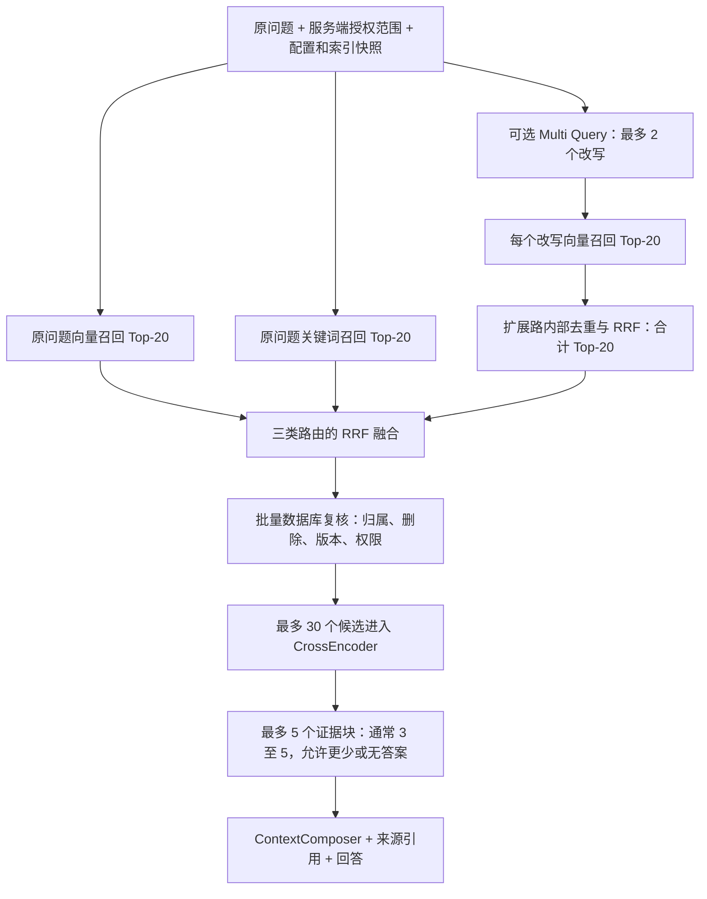

# 附件 G：RAG 四层架构与多路召回设计

版本：v1.4，2026-11-16。根据用户提供的“三路召回与融合”“四层优化框架”两张参考图补充。图片用于讨论设计方向，图中候选数和投入产出评级不作为已验证结论。本附件为待实施的 M3 设计增量，未修改应用实现；继承[主方案 §9](../企业级Agent与模型配置热更新升级方案_2026-11-15.md#s9)、[唯一验收矩阵](./04_里程碑验收矩阵.md)及[个人记忆上下文规则](./07_个人记忆文件功能设计.md)。

## G1. 采用范围与四层边界

采用“四层模块边界 + 两路基础召回 + 有条件的第三路扩展 + RRF + CrossEncoder”。四层是职责划分，执行时先有离线索引，再有查询、召回和重排；图中金字塔的上下位置不表示运行先后。

| 层 | 本项目职责 | 本次决定 |
| --- | --- | --- |
| 索引层：知识怎么存 | 文档/长笔记结构化切片、来源位置、版本/哈希；向量和关键词索引；Outbox/Job/删除补偿 | M3 必做；关键词先评估现有 MySQL 全文能力。声称 BM25 的后端必须实际提供并验证 BM25，MySQL FULLTEXT 统一登记为 keyword，不冒充 BM25。图索引另行选型 |
| 查询层：问题怎么转 | 保留原问题、保护精确实体和约束；生成有限改写；记录 query plan | Multi Query 为 M3 可选开关，通过消融评测再灰度；缺失时间/实体不让模型擅自补全 |
| 召回层：从哪里找 | 对已授权文档与笔记执行 dense/keyword/expanded 三类逻辑路由，候选去重及 RRF 融合 | 基础两路默认；扩展路接收多个子查询，但先合成一个有配额的列表 |
| 重排层：选哪些证据 | 以原问题评估融合候选；CrossEncoder；证据选段、引用、Token 预算 | CrossEncoder 为首选，修复 predict 适配；LLM 重排仅作受控实验，M3 默认不启用 |

保留原方案的统一 RetrievalService：直接 RAG、笔记搜索工具及相关推荐逐步复用同一权限和排名契约。当前代码的双源向量检索、前置距离门控和 compute_score 等问题仍按 M0 修复，不因讨论新架构延后。

图索引需明确含义：若指向量近邻索引的图结构，属于向量存储的索引实现选型；若指实体关系知识图谱/GraphRAG，则属于新的关联检索能力，需独立 ADR、数据和质量证据，不能把两者混为一项。

## G2. 三路召回的准确含义

Multi Query 是查询扩展方式，不是第三种存储索引。它生成不同表述后，仍需调用检索器；首版扩展路仅使用向量检索，避免自动展开为“每个改写 × 全部算法 × 全部数据源”。后续若让改写同时走 keyword，必须更新版本化预算并重新评测。



所有召回先进行授权范围预过滤。数据库复核后才能向远程重排器、摘要模型或回答模型发送正文。融合只处理候选身份、排名等数据，不向 LLM 发送未复核内容。

原问题两路始终保留，并可与一次改写生成并行启动。改写生成失败或到期不影响已完成的基础召回；原问题用于最终重排和回答，不能被某个模型改写替换。HyDE 当前聊天入口关闭，继续默认关闭；将来启用也要保留原问题分支，单独核算预算和评测，不与 Multi Query 默认叠加。

## G3. 起始参数、候选上限与融合算法

以下是设计/压测起点，不是已经证明的最佳参数或产品 SLO。参数以服务端不可变 retrieval_policy_revision_id 管理，每请求固定快照，普通前端请求不能直接提交任意配额。

| 参数 | 初始值及约束 |
| --- | --- |
| query_expansion_mode | off；允许 off/adaptive，adaptive 仅在评测过关且独立提取角色已发布后启用 |
| expanded_query_count | 最多 2 条；去掉空白、与原文相同和规范化后重复的改写 |
| per_source_top_k | 每个逻辑子查询在每个已授权数据源最多取 20 条；首版最多 2 源：文档/笔记 |
| family_top_k | dense、keyword、expanded 各最多 20 条，指该类路由跨源整理后的总量，不是每个知识库各 20 条 |
| raw_candidate_cap | 首版（原问题 2 类 + 最多 2 个向量改写）× 2 源 × 20，即最多 160 条原始命中；不足不补造结果 |
| rrf_rank_constant | 60，所有局部排名从 1 开始；后续参数变更需保存版本与离线对比 |
| family_weights | dense/keyword/expanded 初始均为 1；第三路缺失时只融合可用列表 |
| fused_candidate_cap | 三类路由合计最多 60 个唯一候选，关扩展时最多 40；先去重再截取融合候选 |
| rerank_top_n | 最多 30 个通过数据库复核的候选，按融合排名选取 |
| final_top_k | 最多 5 个证据块，通常为 3—5；按相关性、引用覆盖和 Token 预算减少，可为 0 |
| concurrency | 同一请求最多 4 个实际后端检索调用并发，另受服务级限流/队列约束；逻辑三路不代表只有 3 次网络调用 |
| deadline | 检索阶段初始总预算 5000ms；扩展生成最多 1000ms、重排最多 1500ms，均计入总预算并受父请求剩余预算约束 |

相同语义空间内，同一个问题只生成一次查询向量并供多集合复用；不同语义空间各生成兼容向量，不拿同一个向量跨模型查询。关键词后端未实际接入时显示未启用，不用向量结果伪装第二路。

RRF 的基础公式为 `score(d) = Σ 1 / (60 + rank_i(d))`；缺席列表贡献 0，rank 从 1 开始。本项目的外层为 `Σ weight_family / (60 + family_rank)`，不把 BM25、余弦距离、重排分数混成同一种原始分数。该公式依据见[Elastic RRF 文档](https://www.elastic.co/docs/reference/elasticsearch/rest-apis/reciprocal-rank-fusion)。

融合分三步，顺序固定：

1. 同一子查询跨源整理候选。只有模型、度量和版本可比较时才按原始向量分数合排；不可比较的数据源用 RRF；关键词后端统一返回稳定名次。每个子查询最终最多 20 条。
2. 扩展路内对最多 2 个改写的列表做 RRF，保留多个命中位置，生成最多 20 条的 expanded 列表。
3. 对原问题 dense、原问题 keyword、expanded 三个列表做外层 RRF。每类路由最多投一份排名，避免仅因多生成几个改写就在外层获得更多票。分数相同按稳定 candidate_key 排序。

稳定去重键为 `(scope_id, source_kind, resource_id, resource_version_id, chunk_id)`。不同召回方法命中同一切片时合并 provenance；不能仅按正文哈希合并不同用户、不同版本或不同出处。向量/关键词索引版本保存在来源记录中，不因检索方法不同就把同一切片当成两个证据。

RRF 分数用于相对排序，不是答案可信概率，不能沿用向量距离 0.5 作为融合后的通用阈值。答案是否有证据由校准后的相关性判断、原文支持和覆盖检查决定，不强行凑够 3 条。

## G4. 查询改写、模型角色与个人记忆边界

查询层仅允许生成同一问题的少量检索表达，不承担无界问题分解或自主 Agent 循环。保留原文中的型号/代码标识、否定、时间范围和单位等显式约束；缺失的条件不补造。服务端保存不可变约束并校验改写，模型输出不能提交 user_id、ACL、知识库选择、URL、过滤器、工具或递归调用参数。静态校验不能保证完全无语义漂移，必须有改写漂移评测。

建议输出契约为严格对象，仅有 queries:string[]，最多 2 项，每项不超过 512 字符，总输入/输出 Token 仍由模型预算限制。例如下列两个表达都保留原问题“如何配置 Ollama 的 OpenAI 兼容地址，并进行连接测试”的含义：

```json
{"queries":["Ollama OpenAI 兼容模式 base_url 配置与连接测试","如何设置并测试 Ollama 的 OpenAI 兼容 API 地址"]}
```

单次最多 1 次改写模型调用、输出最多 384 Token，不自动修正重试；空、非法、超限或超时均关闭本轮扩展并记录原因，不能重启整个检索循环。重复查询不增加配额。adaptive 的触发规则需版本化，可针对已定义的多角度/术语不确定问题启用，明确精确 ID 查询默认保持原问题两路。

M3 使用独立角色 `rag_query_expand`。v2 保留 M1 的 17 个角色，首次保存扩展角色时生成 v3 草稿。角色通过能力测试并发布后，仅在服务端运行开关开启时用于检索。v1/v2 发布仍可读取、克隆和恢复。[角色注册表](./01_角色注册表.md)

该角色启用后在同一个模型配置页面提供独立绑定、URL、Key 和提示词，继承 OpenAI 兼容/Ollama 的协议与受控 JSON 解析；必须使用请求固定的发布版本、出站许可和 Token 预算。LLM 重排也不能未经独立能力登记就自动使用聊天模型。CrossEncoder 当前属于独立能力，不为它伪造 OpenAI 聊天接口。

首版改写只接收当前问题及必要的服务端查询规则，不默认发送整份 memory.md、历史对话或知识库正文。个人记忆继续按附件 F 在回答上下文中单独使用；它不能生成授权范围，也不能让改写扩大检索权限。

## G5. 元数据、切片与双索引一致性

向量和关键词索引引用同一份版本化 document_chunks 事实记录。结构感知切片继续保留章节、PDF 页码、表格和代码边界；父子块/邻近块按需扩展时保留被扩展块的身份、位置和独立 Token 消耗。不可把不同版本的相邻块拼成同一段原文。1024 字符/150 重叠是现有实现配置，不作为新策略已经验证的最佳值。

| 元数据位置 | 必需信息与用途 |
| --- | --- |
| 文档/切片事实记录 | 归属、resource_version_id、chunk_id、ordinal、text_hash/text_ref、页码/章节/原文位置、删除/活动版本、parser/chunker 版本 |
| 索引发布清单 | 同一资源水位对应的向量与关键词索引引用；向量语义指纹/维度、关键词 tokenizer/analyzer 及 scoring 算法版本 |
| 查询计划 | request_id、retrieval_policy_revision_id、config_release_id、授权范围/权限版本、index_bindings 和 keyword 索引版本引用 |
| 候选命中记录 | candidate_key、family、subquery_id、source/index 版本、原始名次、score_type/raw_score、融合名次；同块多路命中保留 provenance |
| 回答证据 | 原方案 Evidence 的来源/文档或笔记/切片/版本/标题/位置/原文、最终排名及 rerank_score，引用可重新授权查看 |

关键词索引需按同样的 Outbox/Job/删除机制更新。发布前验证它与向量索引的资源版本和覆盖水位；关键词索引落后时拒绝旧版正文进入重排，报告 partial，不能跨版本凑齐命中。恢复/重建要同时考虑两类索引，现有仅针对向量的 rag_index_versions DDL 不等于已经有完整双索引清单。

上述 retrieval policy、关键词索引版本、M3 角色和命中记录是新增设计契约；完整 ORM、DDL/Alembic、读写 API、JSON Schema 与旧数据迁移仍需在 M3 实施前补齐。本文不冒充已完成字段级存储或已经接入 BM25。

## G6. 故障、预算、缓存与观测

任一召回支路失败时保留其他已完成且有效的结果，记录 success/partial/degraded/error、失败支路和阶段耗时；关键词或扩展失败可回到原问题向量，重排失败回到 RRF。全部支路失败返回检索不可用；支路成功但无证据返回无相关资料，两者不得混为一谈。

正文和权限控制数据不可用时失败关闭，不把缺少权限核验当普通召回降级。所有过滤条件由服务端生成，子查询无权改写；删除/撤权在进入远程模型或真实工具前再次核验。不得先让远程重排器读正文、之后才补权限检查。

预算按队列、连接、Embedding、查询、改写、重排总耗时计算，阶段预算取父请求剩余值。预留重排/证据组装时间，无法在预算内完成的扩展不启动；原问题召回也有独立截止。同步 IO/重排放受限池；过期结果不合并，取消线程中已开始的工作只能尽力而为，不能宣称取消了上游已受理请求。Ollama 冷启动不自动延长整轮 deadline，可选择预热、调大已批准策略预算或本轮关闭扩展。

缓存至少区分认证用户/授权范围与权限版本、查询及约束哈希、模型发布/提示词、retrieval policy、相关索引/分析器版本；涉及相对日期的查询还绑定时间归一化结果，无法稳定归一化时跳过缓存。缓存命中也不能跳过数据库可见性核验。默认 trace 只保存 ID、哈希、排名、条数、时长、Token/费用与降级原因，问题/改写/正文需显式受控诊断才能记录。

## G7. 采用顺序与验证门槛

M0 先完成现有用户隔离、双源路由、重排接口和删除残留修复；M1 维持模型配置/个人 Markdown 记忆范围。M3 顺序为“切片/证据/可靠入库与双索引契约 → 原问题两路召回与 RRF → CrossEncoder → 受控 Multi Query 灰度”。图索引、图谱关系抽取与 LLM 重排放在后续独立 ADR，不能凭图片默认新增数据库或模型调用。

以同一冻结数据快照比较至少 A 向量、B 向量+关键词+RRF、C B+CrossEncoder、D C+Multi Query 四组，分别覆盖精确型号/代码、中文短词、同义表达、多角度问题、无答案、删除与撤权。保存 Recall@20、nDCG@5/MRR、证据/引用正确率、漂移率、P50/P95、每成功问题成本、重复率和各支路增益，不能只看候选总数增加。

冻结集首轮至少 100 题、每类至少 10 题，其余按实际工作负载补齐。B/C/D 的质量门槛、延迟/成本上限由 M0 基线与产品目标批准并版本化，未给出具体阈值时不得标为验收通过；安全场景要求未授权/已删除正文外发与引用均为 0。Multi Query 未证明增益则保持 off，回退到已经通过的基础两路；不因此取消混合检索基础验收。

图中“索引/召回高、查询中、重排低”的投入产出评级不直接继承。优先级由本项目故障、数据和消融结果决定；重排可能有价值，也可能增加延迟，图索引同样需要实际关系型问题和收益证据。唯一验收项见 D 的 M3-05 及 M3-10—M3-15。

依据：[LangChain MultiQueryRetriever](https://reference.langchain.com/python/langchain-classic/retrievers/multi_query/MultiQueryRetriever)说明生成多个查询后调用检索并合并；[Elastic RRF](https://www.elastic.co/docs/reference/elasticsearch/rest-apis/reciprocal-rank-fusion)说明按名次融合；[Microsoft RAG 检索设计](https://learn.microsoft.com/en-us/azure/architecture/ai-ml/guide/rag/rag-information-retrieval)讨论检索、可选查询变换与重排。本文的两级融合、配额、阶段及门槛是本项目决策，不表示这些来源要求同一实现，也不引入其基础设施或最新库作为本项目依赖。
