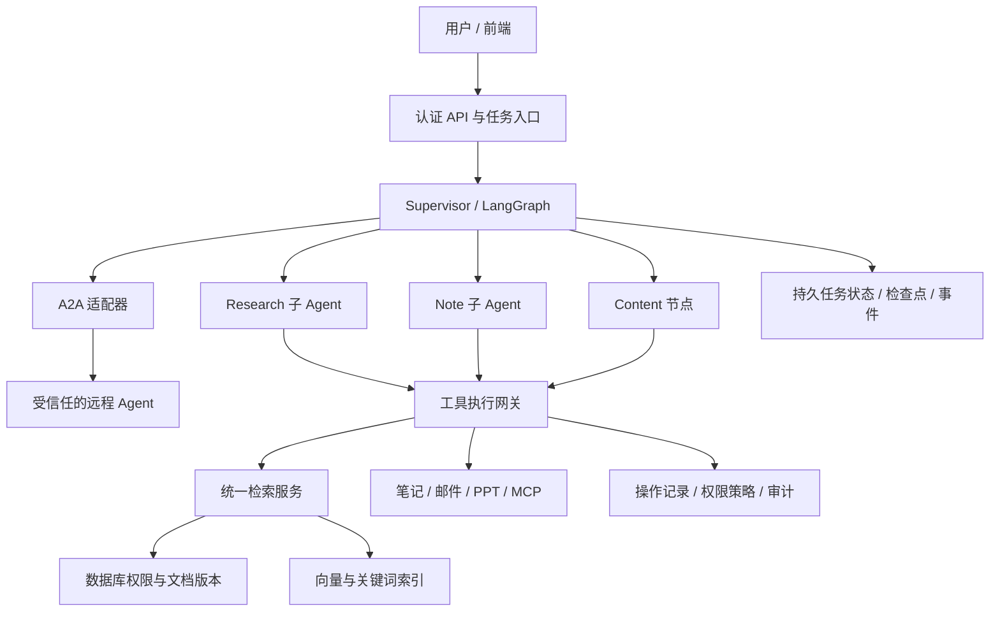

# 多 Agent 与 RAG 企业化架构审查

审查日期：2026-11-14。对象：当前工作区，包括尚未提交的修改。本文提供审查结论与实施方案，没有修改应用实现。

结论：保留现有 ReAct 快速路径，以 Supervisor + 专业子 Agent 演进现有 LangGraph。内部优先采用类型化任务与子图调用；跨部署、跨团队或异构 Agent 再接 A2A。工具层先统一权限、执行记录、幂等与审计，知识库先修正检索正确性和索引生命周期，再扩展多 Agent。

这里的“企业化”指可授权、可恢复、可追溯、可验证和可运维；不存在必须采用某一种向量数据库或必须拆成微服务的统一规范。组织共享库、多租户等要求以未来企业场景为前提，与当前私人笔记产品的功能定位区分。

## 1. 当前实现是什么

实际链路：

```text
POST /chat/query
  ├─ 在 SSE 开始前执行 RAG 与历史压缩
  └─ ChatGraph: classify → react 或 plan → END
       ├─ react：创建通用 ReAct Agent
       └─ plan：LLM 生成计划 → asyncio 分批执行 → 综合 → 可选反思
                    └─ 每个工具步骤仍创建同一种 ReAct Agent
```

- [agent.py:46](/C:/Users/HANXI/Desktop/RagLearnCode/app/ai_service/agent.py:46)：统一 `create_agent`，没有专业 Agent 定义。
- [agent_runner.py:118](/C:/Users/HANXI/Desktop/RagLearnCode/app/ai_service/agent_runner.py:118)：同一个工厂组装工具和模型。
- [plan_execute_agent.py:357](/C:/Users/HANXI/Desktop/RagLearnCode/app/ai_service/plan_execute_agent.py:357)：步骤复用上述执行器。
- [chat_graph.py:110](/C:/Users/HANXI/Desktop/RagLearnCode/app/ai_service/chat_graph.py:110)：外层图只编排分类和两种执行路径。

因此，当前已经有多个模型调用和多个 Agent 实例，但更准确地说是“两种执行策略 + 通用执行器”，尚未建立专业 Agent 的职责、权限、任务契约和恢复边界。多 Agent 不要求不同模型，也不要求不同进程；关键在这些边界。

已有可保留的基础：用户 ID 从后端闭包绑定、工具各自创建数据库会话、笔记服务读取时检查归属、ToolRegistry 做名称冲突检查、模型追踪、工具审计、迭代和超时限制。问题在于它们尚未覆盖完整的多 Agent 执行生命周期。

## 2. 协议选择：内部编排与 A2A 各自负责什么

| 边界 | 推荐机制 | 本项目的判断 |
| --- | --- | --- |
| 同进程内专业 Agent 协作 | LangGraph 子图 + Pydantic 任务/结果 | 第一阶段采用，复用现有技术栈，减少网络和部署成本 |
| 自有服务之间稳定的数据或业务操作 | 内部 API；简单场景直接调用服务 | 检索、笔记更新、PPT 渲染等不必都包装成 Agent |
| 独立部署、异构框架、其他团队的自治 Agent | A2A 适配器 | 需要能力发现、远程任务状态、流式结果和交互时采用 |
| Agent 使用工具与外部资源 | 本地工具适配器 / MCP | 保留现有 MCP 投资，统一经过工具执行策略 |
| 长任务和索引同步 | 持久任务队列 + Worker | 负责调度、确认、重试、恢复；与 A2A 可以同时使用 |

A2A 官方将其定位于 Agent 边界之间的协作，MCP 负责工具和资源接入，两者可以组合。基于这个边界，本项目采用“内部子图、对外 A2A”是工程选择，并非 A2A 不能用于内部通信。[官方比较](https://a2a-protocol.org/latest/topics/a2a-and-mcp/)

本次查询时，官方规范标注最新已发布版本为 1.0.0。实施时锁定规范与 SDK 版本并建立兼容测试，避免混用旧版本字段。A2A 的 Send Message 幂等是可选语义，不能因为有 `messageId` 就认为业务操作不会重复；任务与资源的权限仍需服务端逐次校验。[A2A 规范](https://a2a-protocol.org/latest/specification/)

建议抽象 `AgentExecutor.execute(task, trusted_context)`，分别实现 `LocalGraphExecutor` 与 `A2AExecutor`。Supervisor 面对统一的领域任务，不依赖某一种网络传输。Agent 远程化时替换适配器，而不是重写业务和工具。

### 建议的最小 Agent 划分

| 角色 | 职责与输出 | 工具权限 |
| --- | --- | --- |
| Supervisor | 判断是否拆解、校验计划、分派、汇总；简单问题直接回复 | 委派与任务查询；默认不直接写笔记或发送邮件 |
| Research Agent | 统一检索内部资料、必要时联网，返回证据与缺口 | 只读检索、授权后的网页抓取 |
| Note Agent | 按明确目标形成笔记变更，执行允许的创建/修改 | 笔记读取与受控写入；无邮件发送权限 |
| Content Agent | 根据证据起草讲解、摘要，调用 PPT/TTS 生成服务 | 读取证据与创建产物；无笔记覆盖权限 |
| Reviewer 节点（按需） | 核对证据支持、任务覆盖和格式，不自行扩展任务 | 只读证据；不执行副作用 |

第一阶段只需 Supervisor、Research、Note；PPT/TTS 继续作为服务，复杂度出现后再设 Content Agent。Reviewer 可以是确定性校验加一次模型审阅，不必成为常驻自治 Agent。多 Agent 数量不应成为目标指标。



网关可以先是进程内模块；图中的方框不代表都要部署为微服务。

## 3. Agent 编排问题与解决方案

P1：建议在启用多 Agent 或企业试点之前解决；P2：可在基础正确性修复后随企业功能推进。以下将确定的实现问题与未来能力缺口分别说明。

### A1 · P1：计划没有严格校验，非法依赖还可能让步骤丢失

证据：[计划解析:179](/C:/Users/HANXI/Desktop/RagLearnCode/app/ai_service/plan_execute_agent.py:179)、[拓扑分批:224](/C:/Users/HANXI/Desktop/RagLearnCode/app/ai_service/plan_execute_agent.py:224)。直接从 JSON 填 dataclass，没有校验步骤 ID 唯一、依赖存在、是否成环、工具是否允许。超过步骤上限直接截断，也可能留下无效引用。

更具体的问题：无可执行节点时 `batch = remaining`，然后遍历 `batch` 并修改同一个 `remaining` 列表。离线复核中，`1 → 2 → 1` 的循环计划返回 `[[], [2]]`，步骤 1 丢失；仅有步骤 1 依赖不存在的 999 时返回 `[[]]`。这不是可靠的顺序降级。

方案：Pydantic 严格模型校验 → 工具/Agent 能力与权限校验 → DAG 校验 → 资源冲突校验。非法计划进入有上限的重新规划或明确失败，不能放行。依赖失败时执行 `blocked/skip/replan` 策略；只有依赖成功才释放下游任务。只读步骤可并行，同一笔记的写步骤需要串行化或版本冲突检查。

验收：环、重复 ID、缺失依赖、未知能力、截断引起的非法引用均在执行前拒绝；任何失败计划都不执行副作用。

### A2 · P1：无工具步骤丢掉系统上下文和前置结果

证据：[步骤上下文构造:319](/C:/Users/HANXI/Desktop/RagLearnCode/app/ai_service/plan_execute_agent.py:319)、[无工具分支:436](/C:/Users/HANXI/Desktop/RagLearnCode/app/ai_service/plan_execute_agent.py:436)。虽然上方组装了 `step_system_prompt` 和依赖结果，无工具分支只发送历史与新的 HumanMessage，未使用这份上下文。模拟模型已确认系统策略与依赖标记都没有收到。

方案：所有分支通过统一的消息构造器，显式传入策略、任务说明与依赖 Artifact。依赖结果使用结构化数据或可授权读取的产物引用，避免只有自然语言摘要。当前结果在保存时截为 500 字符，综合时再次截为 300 字符，也应替换为按 Token 预算选择证据，而非按固定字符丢弃后半段。[结果保存:431](/C:/Users/HANXI/Desktop/RagLearnCode/app/ai_service/plan_execute_agent.py:431)、[综合:622](/C:/Users/HANXI/Desktop/RagLearnCode/app/ai_service/plan_execute_agent.py:622)

验收：“搜索 → 比较 → 总结”中，第二步能读取第一步完整的必要字段，最终结论能追溯到证据。

### A3 · P1：会话持久化不能替代执行持久化

证据：[graph.compile:122](/C:/Users/HANXI/Desktop/RagLearnCode/app/ai_service/chat_graph.py:122)、[ChatState:29](/C:/Users/HANXI/Desktop/RagLearnCode/app/ai_service/chat_graph.py:29)、[ChatRouteContext:34](/C:/Users/HANXI/Desktop/RagLearnCode/app/ai_service/chat_route.py:34)。图没有 checkpointer；状态包含队列、模型、服务实例和数据库工厂，不适合作为持久任务状态。Plan 内部整个执行过程又被包在一个外层节点中。

方案：区分可序列化的 WorkflowState 与运行时依赖。把模型/服务放运行时容器，把任务、步骤、产物引用、审批状态、已执行操作 ID 放可恢复状态。以步骤/子图建立检查点边界，增加任务表与事件表。选择与现有数据库兼容、经过验证的持久检查点实现；需要新增数据库时单独作技术决策，不能把内存 Saver 当生产恢复方案。

只在外层 `compile()` 加 checkpointer 不够：如果一个节点内部已经做了多个副作用，恢复时仍可能重跑整个节点。检查点与操作记录必须配合。LangGraph 官方也区分图检查点与跨会话 Store。[持久化说明](https://docs.langchain.com/oss/python/langgraph/persistence)、[子图持久化](https://docs.langchain.com/oss/python/langgraph/use-subgraphs)

验收：Worker 在某一步完成后重启，任务能从确定状态继续，既不漏掉任务，也不重复已完成的写入。

### A4 · P1：并行子任务没有绑定父任务取消生命周期

证据：[create_task:519](/C:/Users/HANXI/Desktop/RagLearnCode/app/ai_service/plan_execute_agent.py:519)。分批生成器没有在 `finally` 中取消和等待其子 Task。复核关闭批次生成器后，两项模拟子任务仍运行。

方案：使用 `TaskGroup` 或可靠的 `try/finally + cancel + gather`，取消向整个任务树传播；队列有容量和背压。另行定义“前端断连”和“用户取消任务”的区别：短对话可随断连取消，已受理的企业长任务可继续在 Worker 执行，用户重连后读取事件。

验收：父任务超时、显式取消、流关闭均无遗留子任务；远程 A2A 任务也收到取消请求并记录最终状态。已被外部系统受理的操作不能承诺通过取消撤回。

### A5 · P1：同一后台任务池混用了核心执行与可丢弃任务

证据：[task_runner.py:38](/C:/Users/HANXI/Desktop/RagLearnCode/app/core/task_runner.py:38) 在 50 项时返回 `None`；[chat_graph.py:166](/C:/Users/HANXI/Desktop/RagLearnCode/app/ai_service/chat_graph.py:166) 随后等待无人写入的队列，finally 又调用 `task.done()`。其他调用方也可能把拒绝的索引、审计、消息保存任务当作已创建。

方案：核心对话采用明确的准入控制，超限立即返回可重试的服务繁忙；可靠任务进入持久队列；标题等增强任务单独设置可丢弃策略。被拒绝的协程应关闭，避免未 await 警告。限制按全局、租户、用户和任务分类设置，不能让审计和索引任务挤掉主执行。

验收：队列饱和时响应有界，重要任务有持久状态，拒绝数与积压可观测。

### A6 · P2：多 Agent 需要统一成本预算和结果契约

现有超时、递归和历史 Token 预算值得保留，但没有整个任务树的模型调用数、费用、委派深度和工具预算。多个 Agent 复用完整历史也会放大延迟与上下文污染。

方案：根任务分配 `deadline / token_budget / cost_budget / max_tool_calls / max_delegation_depth`，子任务只能消耗分配份额。内部类型化任务包含 `task_id、parent_task_id、workflow_id、agent_role、objective、depends_on、input_refs、constraints、schema_version`；结果包含 `status、structured_data、evidence_refs、artifact_refs、error_code、retryable、usage`。可信身份与权限由运行时单独绑定，不能由模型填写。

仅 Supervisor 汇总最终答复，子 Agent 返回结果和证据。共享持久产物，避免广播每个 Agent 的完整对话；工具错误与事实缺口不能靠 Reviewer 的措辞润色变成成功。

## 4. 内置工具层需要哪些改动

### T1 · P1：工具分组是选择机制，尚未成为授权机制

证据：[默认工具组:169](/C:/Users/HANXI/Desktop/RagLearnCode/config/agent.yaml:169) 包含写入、邮件和 MCP；[未知步骤工具:267](/C:/Users/HANXI/Desktop/RagLearnCode/app/ai_service/plan_execute_agent.py:267) 回退全量组；[工具解析为空:700](/C:/Users/HANXI/Desktop/RagLearnCode/app/ai_service/agent_tools.py:700) 反而返回全部内置工具。引入只读 Agent 后，这种兜底会扩大其能力。

方案：ToolRegistry 维护不可变 ToolSpec，独立的 ToolExecutor 在真正调用函数前校验策略。工具发现和执行都必须受控，未知工具/空权限集合一律拒绝；`none` 明确表示无工具，而不是全量。推荐有效权限为“用户权限 ∩ Agent 权限 ∩ 本次任务授权 ∩ 资源 ACL ∩ 数据出站策略”。

不要把现有 `before_tool` 流事件钩子当安全拦截器：它是事件观察，且 [trigger:58](/C:/Users/HANXI/Desktop/RagLearnCode/app/ai_service/agent_middleware.py:58) 会吞掉回调异常。权限校验应包住真实 callable，拒绝后不进入副作用代码。

### T2 · P1：失败后重跑整个 Agent 会重复已成功的副作用

证据：[react_events:99](/C:/Users/HANXI/Desktop/RagLearnCode/app/ai_service/chat_route.py:99)、[修复条件:148](/C:/Users/HANXI/Desktop/RagLearnCode/app/ai_service/chat_route.py:148)、[Plan 修复:353](/C:/Users/HANXI/Desktop/RagLearnCode/app/ai_service/plan_execute_agent.py:353)。`no_retry_tools` 只看最后一个显式报错的工具。邮件已成功，后续模型调用超时，`failed_tool` 仍可能为 `None`，于是整轮重跑。模拟场景得到两次执行、两次“假发信”。创建笔记、生成文件也存在相同类别的重复执行风险。

方案：用稳定的“业务操作 ID”记录每一次副作用，由编排器创建并在重试中复用，不能简单按参数哈希去重正常的重复需求。操作表以 `(tenant_id, operation_id)` 唯一，记录参数摘要与状态，完成后返回已有结果；同一 ID 参数变化必须拒绝。数据库写入与操作完成记录在同一事务；失败恢复只重试确定可重试的阶段。

对于 SMTP 等不能查询或原生去重的外部系统，“请求可能已发送但确认丢失”要进入 `unknown` 待核对，不能自动重发并宣称 exactly-once。优先选择支持幂等键/投递状态查询的供应商。

### T3 · P1：邮件确认目前靠提示词，缺少服务端可验证授权

证据：[send_email:491](/C:/Users/HANXI/Desktop/RagLearnCode/app/ai_service/agent_tools.py:491) 描述要求用户确认，但真正执行只检查格式、长度与频率，没有校验确认记录。[实际发送:544](/C:/Users/HANXI/Desktop/RagLearnCode/app/ai_service/agent_tools.py:544)

方案：涉及外发时生成待确认操作，绑定用户、任务、收件人、正文/附件摘要、有效期与操作 ID。经认证的前端确认接口写授权；ToolExecutor 检查授权与本次参数完全对应，再执行并消费授权。允许企业按角色配置预授权范围，不必对所有只读工具和低影响操作统一弹窗。Agent 说“已确认”不能代替服务端记录。

验收：没有授权记录、参数被替换、授权过期、其他 Agent 复用授权都不能发送。

### T4 · P1：自然语言错误被当作工具成功

证据：[工具错误字符串:455](/C:/Users/HANXI/Desktop/RagLearnCode/app/ai_service/agent_tools.py:455)、[stream.py:153](/C:/Users/HANXI/Desktop/RagLearnCode/app/ai_service/stream.py:153)。工具返回“失败”字符串时没有结构化状态；`on_tool_end` 固定审计 `success=True`。即使返回对象 `status='error'`，复核仍得到成功审计且没有错误标记。MCP 管理器注释本身也说明适配器可能通过错误 ToolMessage 返回失败。

方案：统一结果类型 `ToolResult(status, data, error_code, retryable, operation_id, artifact_refs)`；适配 MCP 的错误结果与异常到相同语义。区分 `not_found / denied / validation_error / transient_error / unknown / succeeded`。业务未找到不一定是基础设施错误，但必须能由工作流判断下一步。不能让模型通过猜测中文错误文本决定是否重试。

### T5 · P1：并发工具审计会配错，且不能区分一次工具调用

证据：[pending deque:118](/C:/Users/HANXI/Desktop/RagLearnCode/app/ai_service/agent_middleware.py:118)、[popleft:127](/C:/Users/HANXI/Desktop/RagLearnCode/app/ai_service/agent_middleware.py:127)、[按名称计时:143](/C:/Users/HANXI/Desktop/RagLearnCode/app/ai_service/stream.py:143)。开始按 A、B 排序，结束按 B、A 排序时，复核得到 A 参数配 B 结果、B 参数配 A 结果；同名并行调用还会覆盖计时。ContextVar 隔离请求并不能修复一个请求内的乱序完成。

方案：按事件 `run_id/tool_call_id` 精确匹配，不用 FIFO 或工具名作唯一键。审计补充 `workflow_id、task_id、agent_id、parent_span_id、operation_id、policy_decision、resource_refs`。审计是结构化脱敏，截取前 500 字不等于脱敏。外发/写入操作的关键审计和执行记录要可靠持久化，一般性能日志可异步采样。

### T6 · P1：当前 MCP SSRF 包装漏掉真实适配器的 Schema 形式

证据：[mcp_manager.py:139](/C:/Users/HANXI/Desktop/RagLearnCode/app/ai_service/mcp_manager.py:139)。守卫只读取 `args_schema.model_fields`。本地安装的 `langchain_mcp_adapters/tools.py:531` 使用 `args_schema=tool.inputSchema`，即字典形式的 JSON Schema；这种情况下直接返回未包装工具。现有 smoke 测试只模拟 Pydantic Schema，未覆盖这条真实契约。离线假工具确认该分支被跳过，没有发出网络请求。

此外，`urls` 数组、嵌套地址没有覆盖；仅在调用前做一次 DNS 检查不能独自覆盖重定向与连接时地址变化。这个发现证明应用层守卫存在缺口，实际是否可访问内网还取决于 MCP 服务自身防护和部署网络策略，不应直接等同于已完成真实 SSRF 利用。

方案：同时支持 JSON Schema 与 Pydantic；为明确的抓取工具校验单/多 URL 参数。MCP 抓取进程放受控网络环境，出口代理在连接和重定向时阻止私网、元数据地址等；业务需要内网知识源时使用独立授权连接器，不与任意公网抓取混用。[MCP 安全实践](https://modelcontextprotocol.io/docs/2025-11-25/tutorials/security/security_best_practices)

### T7 · P2：并发写入与工具运行还需要资源级治理

证据：[update_note_tool:412](/C:/Users/HANXI/Desktop/RagLearnCode/app/ai_service/agent_tools.py:412) 是全文替换，未要求读版本；[note_service.py:274](/C:/Users/HANXI/Desktop/RagLearnCode/app/services/note_service.py:274) 没有乐观锁；[邮件计数:50](/C:/Users/HANXI/Desktop/RagLearnCode/app/ai_service/agent_tools.py:50) 是进程内“检查后发送成功再计数”，并发能同时通过；[MCP 配置:273](/C:/Users/HANXI/Desktop/RagLearnCode/config/agent.yaml:273) 启动使用 `@latest`。

方案：笔记修改带 `expected_version`，数据库以版本条件更新，冲突返回可处理的错误；模型负责提出 patch，服务端负责合并和版本保护。邮件/外部工具用 Redis 原子配额预留或数据库计数，失败释放。工具按提供方设置超时、并发额度、熔断和输出大小限制。锁定 MCP 包版本、构建镜像和 Schema 契约；动态工具名加入来源命名空间，服务凭证与用户授权不要混同。

若将 MCP 改为远程服务，不应把上游用户令牌原样透传到不匹配的下游；使用目标受众明确的凭证或授权交换，并在服务端验证。该要求见上述 MCP 官方安全实践。

### 建议的工具职责拆分

```text
app/tools/specs.py             ToolSpec：名称、版本、Schema、权限、风险、超时、幂等
app/tools/context.py           可信执行上下文，禁止由 LLM 修改
app/tools/executor.py          校验 → 授权 → 配额 → 执行记录 → 调用 → 结果归一 → 审计
app/tools/adapters/langchain.py 原生服务到 LangChain Tool
app/tools/adapters/mcp.py       MCP Schema、错误、调用 ID 和网络策略适配
app/agents/                    Supervisor 与专业子图
app/workflows/                 计划校验、调度、恢复、预算、任务事件
app/protocols/a2a/             对外能力与远程任务适配
```

现有 NoteService、ReviewService、PptService 保留领域职责；先迁移薄工具适配层，不在一份 700 多行的闭包工厂里继续叠加全部运行策略。授权上下文可包含 `subject_id、tenant_id、agent_id、task_id、scopes_ref、trace_id、deadline`，但通过认证/策略系统建立，不能信任 A2A 消息或工具参数中自报的用户 ID。

## 5. 知识库与检索问题及解决方案

### R1 · P1：RAG 路由没有用户过滤，而且只检查上传文档库

证据：[compute_route_score:333](/C:/Users/HANXI/Desktop/RagLearnCode/app/rag/vector_store.py:333) 没有 `where`；[路由短路:275](/C:/Users/HANXI/Desktop/RagLearnCode/app/routers/chat.py:275) 根据它决定是否执行双源 RAG。

触发：用户只有笔记而上传文档库为空，返回无限距离，于是 RAG 直接跳过；如果别的用户上传相似文档，当前用户的路由行为又可能改变。后续正常检索有用户过滤，因此这里不能直接断言返回了其他用户的文档，但跨用户影响决策和漏召回是明确问题。

方案：优先取消全库 Top-1 距离门控，按用户意图执行一次有权限的轻量候选召回，再用结果相关性判断是否需要上下文。若保留门控，必须覆盖知识库与笔记，带相同授权范围；门控分数不能代替最终证据质量评估。

验收：只有笔记也能进入检索；用户 B 的数据变化不影响用户 A 的检索路由与候选结果。

### R2 · P1：重排序 API 不匹配，降级还偏向知识库

证据：[main.py:197](/C:/Users/HANXI/Desktop/RagLearnCode/main.py:197) 实例化 `sentence_transformers.CrossEncoder`；[rag_service.py:242](/C:/Users/HANXI/Desktop/RagLearnCode/app/rag/rag_service.py:242) 调用 `compute_score`。本地 5.6.0 CrossEncoder 源码具有 `predict`，没有该 `compute_score` 方法；异常被捕获后退回原顺序。该接口也可对照 [CrossEncoder 官方文档](https://sbert.net/docs/package_reference/cross_encoder/model.html)。

原顺序是知识库结果在前、笔记在后，而异常/无模型路径直接 `[:top_k]`，所以知识库候选足够时会挤掉全部笔记，未按相关性跨源比较。[合并与降级:108](/C:/Users/HANXI/Desktop/RagLearnCode/app/rag/rag_service.py:108)

方案：建立显式 Reranker 适配接口，对 CrossEncoder 使用 `predict`，将返回的数组/张量归一为一维 float 列表并校验长度。跨源候选先合并排名，重排失败退到融合排名；指标暴露实际启用、失败、降级次数，不应“模型加载成功”就代表重排生效。

验收：构造原顺序错误的候选，确认 reranker 改变顺序；模型缺失/报错时笔记仍能进入最终结果。

### R3 · P1：文档声明混合检索，但当前 RAG 只有向量召回

证据：[vector_store.py:221](/C:/Users/HANXI/Desktop/RagLearnCode/app/rag/vector_store.py:221)、[笔记向量查询:258](/C:/Users/HANXI/Desktop/RagLearnCode/app/rag/vector_store.py:258)。仓库中 BM25/EnsembleRetriever 仅出现在说明文字，没有召回实现；`rank-bm25` 依赖存在不表示已接入。已有笔记 FULLTEXT/LIKE 用于另一条关键词搜索链路，不参与这里的知识库双源融合。

方案：建立统一 RetrievalService，让 RAG、搜索工具、相关推荐复用权限和排名。向量与关键词召回并行，按 chunk ID 去重，再用 RRF 融合排名，最后统一重排。小规模可评估复用现有 MySQL 全文能力，但要给文档切片建可检索记录；文档规模、中文分词和复杂筛选增长后再评估独立搜索服务。不要直接相加未经校准的 BM25 分数与余弦分数。

验收：精确型号、代码标识、中文短词、同义改写都有对应评测；说明文档与实际启用的策略一致。

### R4 · P1：删除失败的残留向量仍可能进入直接 RAG

证据：[知识库删除:436](/C:/Users/HANXI/Desktop/RagLearnCode/app/routers/knowledge_router.py:436) 向量删除失败仍继续删数据库记录；[笔记删除:329](/C:/Users/HANXI/Desktop/RagLearnCode/app/services/note_service.py:329) 向量清理失败只记日志；[RAG 双源查询:102](/C:/Users/HANXI/Desktop/RagLearnCode/app/rag/rag_service.py:102) 直接用向量内容，没有回数据库核验文档/笔记是否仍可见。

与此相比，`NoteService.semantic_search` 会回数据库校验用户和 `deleted_at`，这部分已有正确基础，但直接 RAG 没有复用。[semantic_search:663](/C:/Users/HANXI/Desktop/RagLearnCode/app/services/note_service.py:663)

方案：索引是派生数据，数据库是权限、状态和活动版本的事实来源。先按权限预过滤召回，再批量核验候选的状态/版本/ACL，只有通过后的正文才允许进入重排器、摘要模型或回答上下文。删除先持久化 tombstone，并可靠投递清理任务；索引清理失败不能使文档重新可见。

验收：人为模拟向量删除失败，已删除内容仍不能进入模型；恢复笔记、撤权与版本切换也遵守同一规则。

### R5 · P1：数据库与向量的双写顺序不能保证一致性

证据：[笔记 flush 后立即创建索引任务:116](/C:/Users/HANXI/Desktop/RagLearnCode/app/services/note_service.py:116)，调用者随后才 commit；任务持有 ORM 对象，可能发生未提交即索引、回滚后残留、旧任务晚完成覆盖新内容、删除后旧任务又写回。失败只记日志，后台任务被拒绝也不会补偿。[更新同步:295](/C:/Users/HANXI/Desktop/RagLearnCode/app/services/note_service.py:295)

上传文档虽然改成“先写向量再提交数据库”，仍不是跨库事务：向量成功后数据库 commit 失败会留下孤儿向量。不能仅反转双写顺序就认为原子性已解决。[knowledge_router.py:249](/C:/Users/HANXI/Desktop/RagLearnCode/app/routers/knowledge_router.py:249)、[commit:266](/C:/Users/HANXI/Desktop/RagLearnCode/app/routers/knowledge_router.py:266)

方案：Transactional Outbox。业务数据与索引事件在同一个数据库事务提交；Worker 消费事件，根据资源 ID 与目标版本读取已提交快照，生成确定的切片 ID，幂等构建对应版本。旧版本任务不能覆盖或激活新版本；写后再次检查 tombstone/版本，过期结果不发布并清理。活动版本切换在数据库完成，检索按活动版本验证。重试、死信与对账任务负责修复跨存储不一致。

验收：数据库回滚、Embedding 超时、Worker 重启、乱序更新、删除与更新竞争都不会让旧/未提交内容可见。

### R6 · P1：上传处理绑定 SSE，缺少可靠入库任务生命周期

证据：[event_generator:341](/C:/Users/HANXI/Desktop/RagLearnCode/app/routers/knowledge_router.py:341) 直接承担保存、解析、切片、Embedding 和入库；`app/rag/task_queue.py` 是进程内线程队列，当前未接入该链路，也不能提供重启恢复。去重为“先查后建”，模型只有 MD5 普通索引，缺少相应联合唯一约束。[查重:314](/C:/Users/HANXI/Desktop/RagLearnCode/app/routers/knowledge_router.py:314)、[模型:49](/C:/Users/HANXI/Desktop/RagLearnCode/app/models/knowledge.py:49)

方案：上传保存原文件并创建文档/Job，返回 `202 + job_id`；SSE/轮询只是读取任务事件。Worker 执行 `uploaded → parsing → chunking → embedding → ready/failed`，带持久错误、尝试次数、租约和阶段进度。原文件使用对象存储或已有受控存储抽象，支持多实例读取。按知识库/租户与内容哈希设计唯一约束或去重记录，不能只依靠上传请求的预查询。

验收：关闭页面不丢任务；服务重启能继续；重复提交不会生成重复活动版本；失败阶段可重试和审查。

### R7 · P1：证据与引用链在总结、截断和返回时丢失

证据：[上下文拼接:277](/C:/Users/HANXI/Desktop/RagLearnCode/app/rag/rag_service.py:277) 分别总结文本后只合并字符串；[来源预览:136](/C:/Users/HANXI/Desktop/RagLearnCode/app/rag/rag_service.py:136) 只保留 200 字；[SSE done:658](/C:/Users/HANXI/Desktop/RagLearnCode/app/routers/chat.py:658) 又只返回 100 字和来源类别，丢掉文档 ID、位置、版本等元信息。无法稳定完成“具体论断 → 原始段落”的审查。

方案：采用 Evidence 对象，至少有 `source_id、document_id/note_id、chunk_id、version、title、page/section、original_text、retrieval_rank、rerank_score`。摘要只作为可选压缩，始终保留到原始证据的映射；输出引用 ID，并提供有权限检查的来源查看接口。回答时区分证据支持与推断，无证据应说明缺口，不能仅因向量库有结果就认为问题已得到支持。

验收：用户点击引用能到达对应版本和段落；删除或撤权后历史引用入口也重新授权；引用精度可独立评分。

### R8 · P2：切片和索引缺少统一版本，长笔记与 PDF 处理不足

证据：[笔记整篇一个向量:806](/C:/Users/HANXI/Desktop/RagLearnCode/app/services/note_service.py:806)；[PDF 跨页合并:139](/C:/Users/HANXI/Desktop/RagLearnCode/app/routers/knowledge_router.py:139) 不保留页码，解析失败还把 PDF 二进制按 UTF-8 解码后继续入库。上传切片虽有 `section_title/chunk_index`，但没有稳定 chunk ID、索引版本或文档修订。向量初始化只检查维度，无法识别“维度相同但模型不同”的向量空间变化。[维度检查:131](/C:/Users/HANXI/Desktop/RagLearnCode/app/rag/vector_store.py:131)

方案：文档和长笔记统一切片契约；保留标题、章节、页码、表格/代码块等结构，父子块按需扩展上下文。扫描 PDF 进入 OCR 流程，无可靠文本就明确失败或待 OCR，不能假装成功。为文档/切片记录内容哈希与 `parser_version、chunker_version、embedding_provider/model/revision、dimension、index_version`。模型/切片策略变更构建新索引，评测后切换活动版本并保留回滚。

验收：长笔记末段可被召回、PDF 引用能显示页码、空文本不会成功发布、同维度换模型也必须触发兼容检查。

### R9 · P2：异步接口仍存在阻塞操作，检索预算与降级不足

证据：[同步 Chroma query:221](/C:/Users/HANXI/Desktop/RagLearnCode/app/rag/vector_store.py:221)、[同步 upsert:190](/C:/Users/HANXI/Desktop/RagLearnCode/app/rag/vector_store.py:190)、[PDF 解析:139](/C:/Users/HANXI/Desktop/RagLearnCode/app/routers/knowledge_router.py:139)。这些操作位于 async 链路，可能阻塞事件循环。`PersistentClient` 是本地部署形态，进程内单例不能代替多实例部署、容量和运维策略，但也不能据此断言 Chroma 一定不适合企业。

检索在 SSE 开始前完成，用户看到首个事件的时间包含 RAG 耗时；当前等待 5 秒主要是等初始化事件，不是整条检索超时。双源 `gather` 任一路异常会丢掉整体检索结果，摘要调用也没有阶段总预算。[chat.py:266](/C:/Users/HANXI/Desktop/RagLearnCode/app/routers/chat.py:266)、[RAG:102](/C:/Users/HANXI/Desktop/RagLearnCode/app/rag/rag_service.py:102)

方案：同步 IO 使用受限线程池或适当异步客户端，CPU 解析/推理迁移 Worker 或模型服务；在同一向量空间内查询只生成一次 query embedding。检索阶段设置 deadline、并发限制与 `partial/degraded/error` 状态，优先返回可用证据并准确告知缺口；先发已受理/检索中事件。多实例时评估独立向量服务、备份恢复和索引发布策略，按容量实测选型。

HyDE 当前聊天入口明确 `use_hyde=False`，所以不能把它列为当前聊天慢的必经步骤。[调用:295](/C:/Users/HANXI/Desktop/RagLearnCode/app/routers/chat.py:295) 将来启用时保留原问题召回并与 HyDE 结果融合，用评测决定是否启用；不要让假设性回答取代唯一检索依据。LLM 摘要同样应按需要启用。

Token 配额目前也有实现问题：调用端传 `"" * rag_context_max` 实际是空字符串；`fixed_budget` 已含 RAG 预留，`allocate` 又减实际 RAG Token；此外未对实际工具 Schema、长输入和工具输出统一硬裁剪。[调用:360](/C:/Users/HANXI/Desktop/RagLearnCode/app/routers/chat.py:360)、[预算:150](/C:/Users/HANXI/Desktop/RagLearnCode/app/services/token_budget.py:150)。应统一按完整待发请求计算 Token，明确“上限预留”和“实际消耗”只计一次，并为任务树设置总预算。

### R10 · 企业共享场景 P1：当前用户过滤不是组织知识权限模型

当前 `where={user_id: ...}` 适合私人知识库基础隔离，不应描述为完全没有隔离。但企业组织共享库还需要 `tenant、knowledge_base、owner、group/role ACL、sensitivity、active_version、retention` 等模型。不能只新增 `tenant_id` 就把同租户全部数据默认共享。

方案：显式 KnowledgeBase、Document、DocumentVersion、Chunk、ACL 和 IngestionJob 实体；服务端从认证主体解析范围，按授权范围召回并在内容进入模型前重新核验。权限变更应使缓存失效；未来检索结果缓存需包含租户/知识库、权限版本、索引版本、模型/排序配置。远程 Agent 只收到任务所需资料，不广播完整知识库或历史。

验收：同组织不同项目、跨租户、撤权、离职、缓存命中、导出与远程委派均有权限回归用例。

### R11 · P2：现有黄金评测不能证明检索正确性

证据：[golden_cases.json](/C:/Users/HANXI/Desktop/RagLearnCode/tests/eval/golden_cases.json) 多数按关键词任一命中判断，知识库案例只要求出现“知识库/架构”等词，安全案例也可能因回复包含“邮箱”而通过。这能作冒烟检查，不能衡量候选召回、真实工具副作用或是否引用正确资料。

方案：建立包含期望文档/chunk 和答案证据的评测集；单独衡量 Recall@K、nDCG/MRR、引用精度、证据支持率、无答案识别、撤权/删除召回为零、任务成功率、重复副作用次数、P95 延迟与成本。安全用例检查模拟工具实际调用和授权决策，不只检查回复措辞。先形成基线，阈值由产品目标和实测共同确定，本文不臆造达标数字。

## 6. 建议的索引与任务最小数据模型

```text
workflow_runs(id, tenant_id, subject_id, status, deadline, budget, state_version)
agent_tasks(id, workflow_id, parent_id, role, status, input_refs, result_refs, attempt)
task_events(task_id, sequence, type, payload, created_at)
tool_operations(tenant_id, operation_id UNIQUE, task_id, tool, args_hash, status, result_ref)
operation_approvals(operation_id, subject_id, payload_hash, expires_at, consumed_at)
knowledge_bases(id, tenant_id, access_policy)
documents(id, knowledge_base_id, owner_id, status, active_version, deleted_at)
document_versions(id, document_id, content_hash, parser_version, chunker_version, index_version)
document_chunks(id, document_version_id, ordinal, source_location, text_ref, text_hash)
outbox_events(id, aggregate_id, aggregate_version, type, payload, status)
ingestion_jobs(id, document_version_id, stage, status, attempts, lease_expires_at, error_code)
```

这是审查用逻辑模型，不是要求一次性建立全部表。数据库里的状态是事实来源，向量/关键词索引是可以重建的派生数据。可以继续使用 MySQL；新增基础设施应有容量、恢复和运维依据。

## 7. 分阶段实施与审查关口

| 阶段 | 工作范围 | 验收关口 |
| --- | --- | --- |
| 0：先修正确性 | RAG 用户/双源路由、reranker 接口和融合降级、非法 DAG、无工具上下文、子任务取消、错误结果归一、SSRF Schema 适配 | 上述定向场景全部覆盖，现有功能回归通过 |
| 1：统一执行与数据可靠性 | ToolSpec/Executor、权限矩阵、操作 ID 与授权记录、精确审计、笔记版本锁、Outbox、文档状态核验、Job 入库 | 故障注入下无越权、无旧内容重新可见、无盲目重复外发 |
| 2：引入最小多 Agent | Supervisor + Research + Note；类型化任务/产物、可持久化子图、全局预算、只读并行/写冲突策略 | 相比单 Agent 基线，业务成功率有提升且延迟/成本可接受 |
| 3：按边界接 A2A | 远程执行适配、Agent Card、服务身份与委派授权、Task/Artifact 状态映射、取消/重连/版本兼容 | 远程超时、断连、重复消息、撤权与异常结果均能恢复和审计 |
| 4：企业共享与规模化 | 知识库 ACL、统一混合检索、索引版本发布、容量规划、备份恢复、评测与告警 | 权限/检索质量/恢复与容量指标达到已审定目标 |

A2A 接入时还需审查：可信 Agent 注册表和目标地址允许列表；获取/订阅/取消任务时的逐次权限检查；委派权限只能收窄；Artifact 以有权限的引用交付，禁止把本地文件路径当远程下载地址；Webhook 校验与出口策略；事件序号与断线恢复。不要让模型根据任意 URL 自动发现并信任远程 Agent。

建议先审定三个决定：① 内部采用 LangGraph 子图，对外保留 A2A 适配；② 所有内置/MCP 工具统一经过执行网关；③ 业务数据库为权限和活动版本事实来源，采用 Outbox 驱动索引。它们决定后续迁移方向，其余实现可以逐步替换。

## 8. 本次验证范围与结果

已运行：

```text
.venv/Scripts/python.exe -m pytest tests/test_smoke.py tests/test_reflection.py tests/test_vector_store_cache.py -q -p no:cacheprovider
结果：69 项通过。
```

Windows 沙箱创建 asyncio 事件循环时阻塞于本机 socket；经授权在沙箱外重跑后通过。该阻塞属于验证环境问题，没有将其计作项目缺陷。

另外使用全部为假模型/假工具/假存储的离线脚本定向复核，未调用真实 LLM、未发邮件、未访问内网、未写业务数据库：

本地辅助产物：[复核脚本](/C:/Users/HANXI/Desktop/RagLearnCode/.cache/architecture_review_probe.py)、[复核输出](/C:/Users/HANXI/Desktop/RagLearnCode/.cache/architecture_review_evidence.json)。它们位于已忽略的 `.cache`，不作为应用实现或正式测试提交。

| 复核场景 | 结果 |
| --- | --- |
| JSON Schema 字典形式 MCP 工具 | 应用层 SSRF 包装被跳过 |
| 循环依赖计划 | 得到 `[[], [2]]`，步骤丢失 |
| 不存在的依赖 | 得到 `[[]]`，步骤未执行且未正确拒绝 |
| 无工具步骤 | 系统策略和前置结果均未发给模拟模型 |
| CrossEncoder 形式的 predict 接口 | 实际代码没有调用，走异常降级 |
| 错误 ToolMessage 经 on_tool_end 返回 | 审计仍写成功，缺少错误事件 |
| 邮件成功后模型失败 | 整轮修复，模拟发信计数为 2 |
| 关闭并行步骤生成器 | 仍有 2 个模拟子任务运行 |
| 工具 A/B 乱序完成 | A 参数配 B 结果，B 参数配 A 结果 |

本次没有进行真实多租户渗透、真实外部投递、负载测试或恢复演练。其余故障链依据调用顺序和状态校验路径作静态判断，已在条目中说明触发条件。现有测试通过不代表这些未覆盖场景已经满足企业要求。
